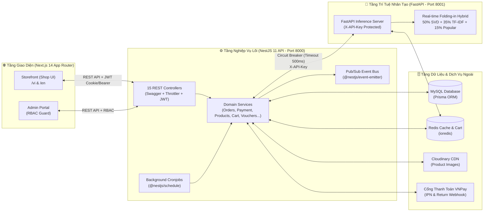

# 🛒 Hệ Thống Thương Mại Điện Tử Thiết Bị Điện Tử & Gợi Ý Sản Phẩm Cá Nhân Hóa (DATN)

Nền tảng Thương mại Điện tử chuyên kinh doanh **Linh kiện PC, Laptop, Màn hình & Thiết bị Điện tử** tích hợp **Hệ thống Gợi ý Sản phẩm Lai (Real-time Folding-in Hybrid Recommendation System)**, hỗ trợ đa ngôn ngữ (`vi` / `en`), thanh toán trực tuyến **VNPay**, chương trình **Flash Sale chống Overselling**, và **Hệ thống Hạng Thành Viên VIP**.

---

## 📐 1. Kiến trúc Tổng thể Hệ thống (System Architecture)

Hệ thống được thiết kế theo mô hình **Decoupled Micro-services** gồm 3 tầng độc lập giao tiếp qua RESTful API, Pub/Sub Event Bus (`@nestjs/event-emitter`) và bộ nhớ đệm phân tán **Redis**:



---

## ✨ 2. Các Tính năng Nổi bật (Key Features)

### 🧠 2.1. Hệ thống Gợi ý Sản phẩm Lai (Real-time Folding-in Hybrid Recommendation)

- **Kết hợp 3 mô hình học máy** được huấn luyện trên bộ dữ liệu **Amazon Electronics Reviews 2023** (`ml/scripts/02_train_models.py`):
  $$\text{Score}(i) = 0.50 \cdot \widehat{\text{SVD}}(i, H) + 0.35 \cdot \widehat{\text{TFIDF}}(i, H) + 0.15 \cdot \widehat{\text{Pop}}(i)$$
  - **Collaborative Filtering (`TruncatedSVD`)**: Phân rã ma trận tương tác tiềm ẩn kết hợp kỹ thuật **SVD Item Folding-in** thời gian thực từ lịch sử hành vi có trọng số $H = \{(p_k, w_k)\}$ (`PURCHASE: 5`, `ADD_TO_CART: 3`, `WISHLIST_ADD: 2`, `SEARCH: 2`, `VIEW: 1`, `CURRENT_PRODUCT: 6`).
  - **Content-Based Filtering (`TfidfVectorizer` 5.000 features)**: Tính độ tương đồng ngữ nghĩa Cosine trên tiêu đề & mô tả kỹ thuật sản phẩm.
  - **Popular Baseline (Bayesian Weighted Average)**: Công thức chuẩn IMDB $W = \frac{R \cdot v + C \cdot m}{v + m}$ làm prior ổn định và xử lý Cold-start.
- **Kiến trúc Chịu lỗi 3 Tầng (Zero Empty State & < 500ms SLA)**:
  1. **Tầng 1**: Gọi sang FastAPI ML Service với `AbortController` timeout **500ms**, bảo toàn thứ tự xếp hạng `score` và quy đổi sang huy hiệu độ khớp **`% AI Match` (`aiScore`: `75%–99%`)** trên giao diện.
  2. **Tầng 2**: Tự động chuyển sang **DB Category-Seed & Pre-computed Fallback** nếu ML Service quá thời gian chờ hoặc đang bảo trì.
  3. **Tầng 3**: **Popular Baseline Fallback** kết hợp bộ đệm Redis 2 mức TTL (`3600s` cho Hybrid / `120s` cho Fallback) và tự động xóa cache khi phát sinh hành vi tương tác mới.

### 🛍️ 2.2. Phân hệ Mua sắm, Giỏ hàng & Thanh toán An toàn

- **Tìm kiếm & Khám phá**:
  - Tìm kiếm đa điều kiện (từ khóa, danh mục phân cấp cha-con, khoảng giá, điểm đánh giá, sắp xếp), **Comprehensive Search Modal** lưu lịch sử tìm kiếm, và thanh trượt **Sản phẩm vừa xem (Recently Viewed)** đồng bộ giữa Guest (`localStorage`) và User (MySQL).
- **Giỏ hàng Lai (Hybrid Redis + MySQL Write-Behind)**:
  - Thao tác thêm/sửa/xóa giỏ hàng đạt tốc độ $O(1)$ trên Redis (`cart:{userId}`), tự động hợp nhất giỏ hàng Guest khi đăng nhập (`POST /cart/merge`) và đồng bộ xuống MySQL qua Cronjob định kỳ.
- **Đặt hàng, Chính sách Đặt cọc & Thanh toán lại VNPay (Repay Flow)**:
  - Hỗ trợ **COD**, **VNPay toàn phần**, và **Chính sách Đặt cọc bắt buộc `50.000đ`** đối với đơn hàng COD có tạm tính `< 200.000đ` (áp dụng cho cả giao tận nơi `DELIVERY` và nhận tại cửa hàng `PICKUP`).
  - Hỗ trợ **Thanh toán lại (Repay Flow)** trong thời hạn **30 phút** (`paymentExpiresAt`) hoặc mở lại đơn hết hạn tự động nếu tồn kho, sản phẩm và các ưu đãi vẫn còn hiệu lực.
  - **Bắt Thanh toán Trùng (Bidirectional Duplicate Payment Detection)**: Đối soát 2 chiều giữa mã giao dịch `vnp_TxnRef` (45 ký tự) và trạng thái đơn hàng, tự động gắn cờ `isOrphanedPayment` và phát sự kiện cảnh báo hoàn tiền khi phát hiện thanh toán chồng chéo.
- **Chống Overselling (Atomic Concurrency Control)**:
  - Toàn bộ thao tác trừ tồn kho (`stock`) và chiếm suất **Flash Sale (`ProductDiscount.soldCount < maxQuantity`)** hay **Voucher (`usedCount < usageLimit`)** đều sử dụng câu lệnh nguyên tử `$executeRaw` có điều kiện trong Database Transaction.

### 🛡️ 2.3. Phân hệ Quản trị (Admin Portal) & Tự động hóa

- **Dashboard Thống kê**: Biểu đồ doanh thu theo tháng, tỷ trọng trạng thái đơn hàng, sản phẩm sắp hết hàng, và đơn hàng mới nhất.
- **Quản lý Nghiệp vụ Toàn diện**: Quản lý Sản phẩm (upload ảnh Cloudinary), Danh mục phân cấp, Chương trình Flash Sale (kiểm tra chống chồng lấn khung giờ), Mã giảm giá Voucher (chặn cộng dồn voucher `%` lên hàng Flash Sale), Đơn hàng & Yêu cầu trả hàng (14 ngày), Đánh giá sản phẩm (tích hợp mô hình AI phân tích cảm xúc `SentimentType`), và Người dùng.
- **Tác vụ Ngầm (Cronjobs)**:
  - Tự động thu hồi các đơn `PENDING_PAYMENT` quá hạn 30 phút và hoàn trả tồn kho + suất Flash Sale + lượt dùng Voucher + điểm VIP.
  - Tự động chuyển đơn `DELIVERED` sang `COMPLETED` sau 14 ngày không phát sinh khiếu nại và cộng điểm tích lũy nâng hạng **VIP (`BRONZE` → `SILVER` → `GOLD` → `PLATINUM`)**.

---

## 🛠️ 3. Công nghệ Sử dụng (Tech Stack)

| Phân hệ                        | Công nghệ & Thư viện Chính                                                                                                                                                                                                                                                                                |
| :----------------------------- | :-------------------------------------------------------------------------------------------------------------------------------------------------------------------------------------------------------------------------------------------------------------------------------------------------------- |
| **Frontend (`code/frontend`)** | **Next.js 14.2 (App Router)**, **TypeScript 5**, **Tailwind CSS**, **next-intl** (`vi` / `en`), **TanStack React Query v5**, **Zustand**, **React Hook Form + Zod**, **Lucide Icons**                                                                                                                     |
| **Backend (`code/backend`)**   | **NestJS 11**, **TypeScript 5**, **Prisma ORM 6 (MySQL)**, **Redis (`ioredis`)**, **Passport JWT + Google OAuth2**, **nestjs-i18n**, **@nestjs/event-emitter**, **@nestjs/schedule**, **@nestjs/throttler**, **@nestjs/swagger**, **VNPay SDK**, **Cloudinary**, **Nodemailer**, **@xenova/transformers** |
| **ML Service (`ml/`)**         | **Python 3.11+**, **FastAPI**, **Uvicorn**, **Scikit-learn (`TruncatedSVD`, `TfidfVectorizer`)**, **SciPy**, **NumPy**, **Pandas**, **Joblib**, **Redis (`redis.asyncio`)**                                                                                                                               |
| **Kiểm thử & CI/CD**           | **Jest** (Unit & E2E Tests), **ESLint + Prettier**, **Husky + lint-staged**, **GitHub Actions CI** (`.github/workflows/ci.yml`)                                                                                                                                                                           |

---

## 📂 4. Cấu trúc Thư mục Dự án (Project Structure)

```text
DATN/
├── .github/workflows/          # GitHub Actions CI Pipeline (lint, typecheck, unit tests)
├── .agents/                    # Quy chuẩn kiến trúc, Rules & Skills cho AI Agent
├── code/
│   ├── backend/                # NestJS 11 Backend API (Port 8000)
│   │   ├── prisma/             # Schema CSDL (18 models), Migrations & Seed scripts
│   │   ├── src/
│   │   │   ├── common/         # Constants, Decorators, Filters, Guards (JWT, Roles), Interceptors
│   │   │   ├── database/       # PrismaService
│   │   │   ├── i18n/           # Từ điển đa ngôn ngữ Backend (vi / en)
│   │   │   └── modules/        # 18 Domain Modules (auth, products, categories, cart, orders,
│   │   │                       #   payment, promotions, vouchers, reviews, wishlist,
│   │   │                       #   activities, users, admin, mail, upload, locations, redis, tasks)
│   │   └── test/               # E2E Tests
│   │
│   └── frontend/               # Next.js 14 App Router Frontend (Port 3000)
│       └── src/
│           ├── app/[locale]/   # Routing đa ngôn ngữ: (shop), (auth), profile, admin
│           ├── components/     # UI Components: base/ (icons, primitives), features/, admin/, home/
│           ├── constants/      # Hằng số dùng chung (Single Source of Truth)
│           ├── hooks/          # Custom React Query & Domain Hooks
│           ├── messages/       # Từ điển đa ngôn ngữ Frontend (vi / en theo từng module)
│           ├── services/       # Tầng giao tiếp API (Axios client + services)
│           ├── store/          # Zustand Stores (Cart, Recently Viewed, Auth)
│           ├── types/          # Định nghĩa TypeScript Interfaces
│           └── utils/          # Các hàm tiện ích định dạng tiền tệ, ngày tháng, phân loại lỗi
│
├── ml/                         # Hệ thống Machine Learning Gợi ý Sản phẩm (Port 8001)
│   ├── data/                   # Tập dữ liệu huấn luyện/kiểm thử (train.csv, test.csv, meta)
│   ├── models/                 # Trọng số mô hình đã đóng gói (hybrid_model.pkl, popular_model.pkl)
│   ├── scripts/                # Pipeline: 00_download -> 01_eda -> 02_train_models -> 03_evaluate_metrics
│   ├── service/                # FastAPI Server (api/, core/, models/, schemas/)
│   └── evaluation_report.json  # Kết quả đánh giá học thuật (Precision@10, Recall@10, NDCG@10, RMSE)
│
├── docs/                       # Tài liệu Đặc tả & Thiết kế Hệ thống
│   ├── requirements/           # SRS (Software Requirements Specification)
│   ├── architecture/           # ERD, Sequence Diagrams (VNPay IPN, Checkout...)
│   ├── plans/                  # Project Plan, Báo cáo Đánh giá Mô hình Học máy
│   └── backlogs/               # Sprint Backlogs (Sprint 1 -> Sprint 5)
│
└── summary/                    # Nhật ký tổng hợp thay đổi trước mỗi đợt Commit
```

---

## 🚀 5. Hướng dẫn Cài đặt & Khởi chạy (Getting Started)

### 5.1. Yêu cầu Hệ thống (Prerequisites)

- **Node.js**: `>= 20.x` & **npm**
- **Python**: `>= 3.11` (khuyến nghị cài đặt kèm trình quản lý gói `uv` hoặc `pip`)
- **MySQL**: `>= 8.0`
- **Redis**: `>= 7.0`

### 5.2. Khởi chạy Dịch vụ Machine Learning (`ml/` — Port `8001`)

```bash
# 1. Cài đặt thư viện Python
pip install -r ml/requirements.txt

# 2. (Tùy chọn) Huấn luyện lại mô hình và xuất báo cáo đánh giá học thuật
uv run ml/scripts/02_train_models.py
uv run ml/scripts/03_evaluate_metrics.py

# 3. Khởi chạy FastAPI Inference Server tại cổng 8001
uvicorn ml.service.main:app --host 0.0.0.0 --port 8001 --reload
```

- **Swagger UI của ML Service**: `http://localhost:8001/docs`

### 5.3. Khởi chạy Backend NestJS (`code/backend` — Port `8000`)

```bash
cd code/backend

# 1. Cài đặt dependencies
npm install

# 2. Cấu hình biến môi trường (.env)
# Khai báo DATABASE_URL, REDIS_HOST, REDIS_PORT, JWT_SECRET,
# ML_SERVICE_URL=http://localhost:8001, ML_API_KEY=test_api_key_123,
# VNP_TMN_CODE, VNP_HASH_SECRET, VNP_RETURN_URL, CLOUDINARY_*

# 3. Đồng bộ Prisma Schema & Seed dữ liệu mẫu
npx prisma generate
npx prisma migrate deploy
npm run db:seed-locations
npm run db:seed-admin

# 4. Khởi chạy Backend ở chế độ Development
npm run start:dev
```

- **Swagger API Documentation của Backend**: `http://localhost:8000/api/docs`

### 5.4. Khởi chạy Frontend Next.js (`code/frontend` — Port `3000`)

```bash
cd code/frontend

# 1. Cài đặt dependencies
npm install

# 2. Cấu hình biến môi trường (.env.local)
# NEXT_PUBLIC_API_URL=http://localhost:8000

# 3. Khởi chạy máy chủ phát triển (Next.js Turbo)
npm run dev
```

- **Giao diện Cửa hàng (Tiếng Việt / Tiếng Anh)**: `http://localhost:3000/vi` hoặc `http://localhost:3000/en`
- **Giao diện Quản trị (Admin Portal)**: `http://localhost:3000/vi/admin`

---

## 🧪 6. Kiểm thử & Đảm bảo Chất lượng (Testing & Quality Assurance)

```bash
# Kiểm tra Linter, Type Safety và chạy Unit Tests tại Backend
cd code/backend
npx eslint "src/**/*.ts"
npx tsc --noEmit
npm test

# Kiểm tra Type Safety và Đồng bộ Đa ngôn ngữ i18n tại Frontend
cd code/frontend
npx tsc --noEmit
node scripts/check-i18n.js
```

---

## 📚 7. Danh mục Tài liệu Tham khảo trong Repo

- **Kế hoạch Dự án & Lộ trình Sprint**: [`docs/plans/project_plan.md`](file:///c:/Users/nguye/Desktop/CODE/DATN/docs/plans/project_plan.md)
- **Báo cáo Đánh giá Học thuật Mô hình Gợi ý**: [`docs/plans/model_evaluation_report.md`](file:///c:/Users/nguye/Desktop/CODE/DATN/docs/plans/model_evaluation_report.md)
- **Sơ đồ Thực thể Liên kết (Database ERD)**: [`docs/architecture/erd.md`](file:///c:/Users/nguye/Desktop/CODE/DATN/docs/architecture/erd.md)
- **Biểu đồ Tuần tự Thanh toán & Đối soát VNPay IPN**: [`docs/architecture/sequence_vnpay_ipn.md`](file:///c:/Users/nguye/Desktop/CODE/DATN/docs/architecture/sequence_vnpay_ipn.md)
- **Tiến độ Chi tiết Sprint 5**: [`docs/backlogs/sprint5/tasks.md`](file:///c:/Users/nguye/Desktop/CODE/DATN/docs/backlogs/sprint5/tasks.md)
