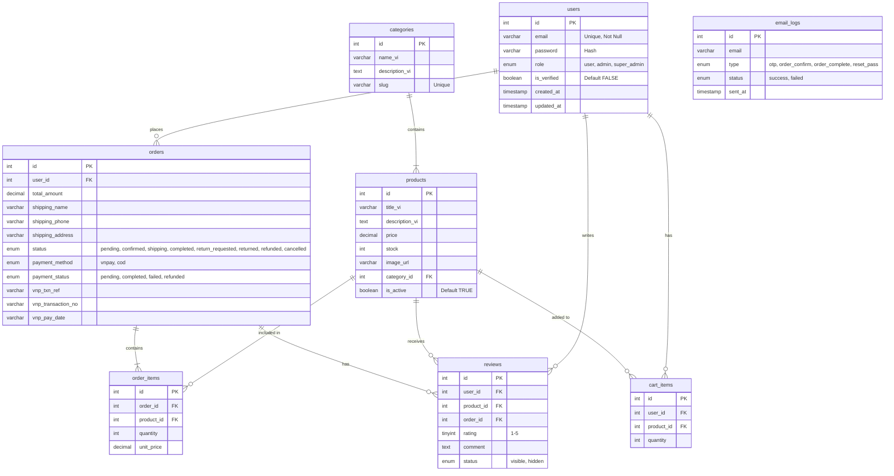

# Entity-Relationship Diagram (ERD)

Sơ đồ ERD thể hiện cấu trúc cơ sở dữ liệu của hệ thống, bao gồm các bảng chính và mối quan hệ giữa chúng, được thiết kế cho hệ thống Thương mại điện tử và lưu trữ dữ liệu để phục vụ cho hệ thống Gợi ý (Recommender System).

