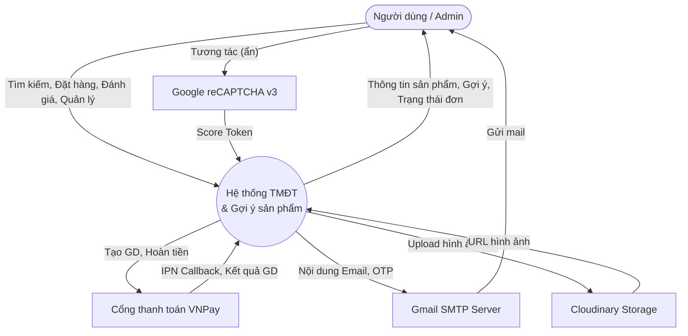
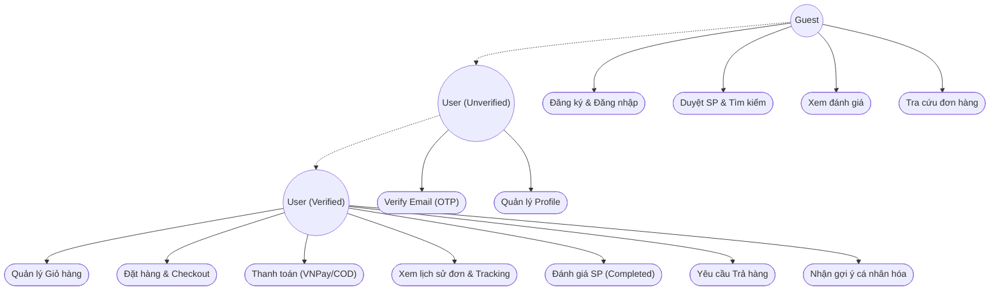
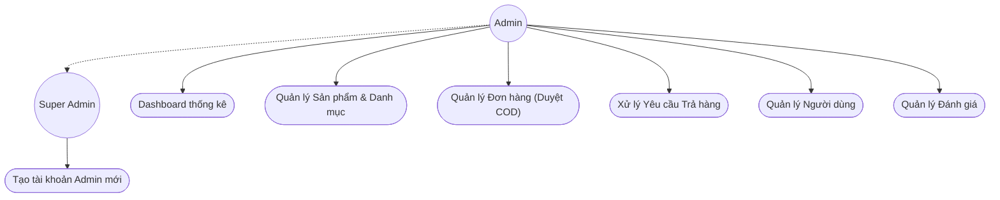
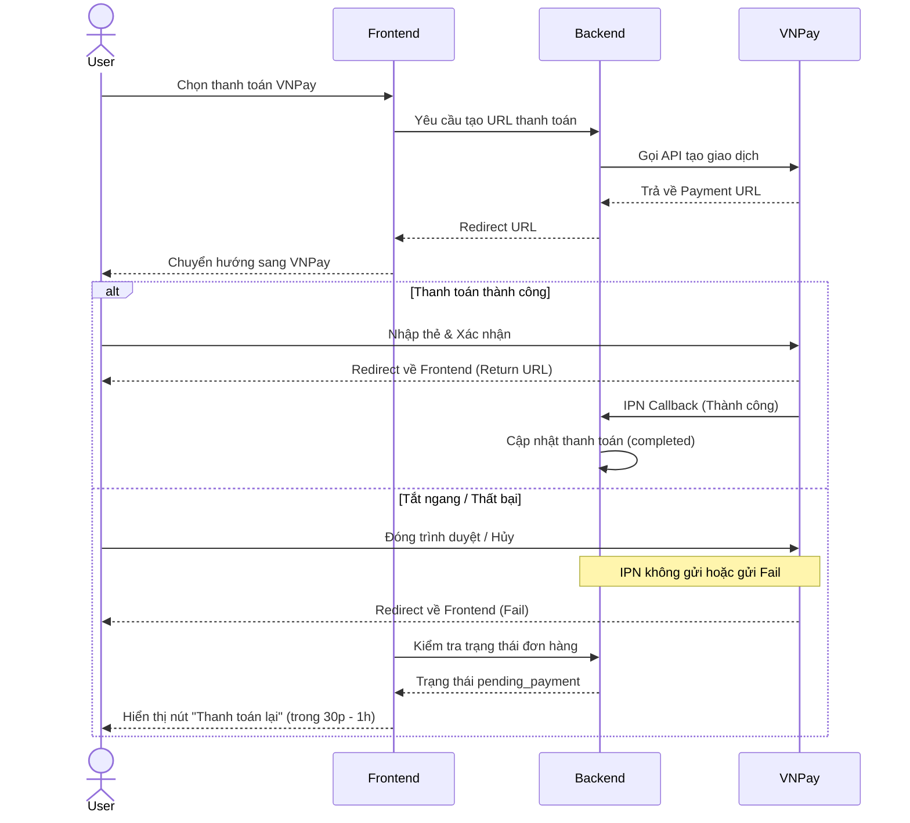
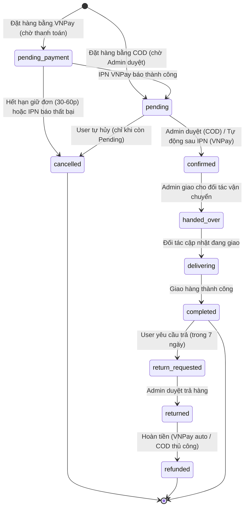

# TÀI LIỆU SRS: WEBSITE TMĐT ĐỒ ĐIỆN TỬ & HỆ THỐNG GỢI Ý (HYBRID RECOMMENDER)

## 1. Giới thiệu (Introduction)

### 1.1. Mục đích (Purpose)
Dự án nhằm xây dựng một Website Thương mại điện tử chuyên bán các sản phẩm đồ điện tử, kết hợp với Hệ thống gợi ý sản phẩm thông minh (Hybrid Recommender System). Mục đích cụ thể bao gồm:
1. **Trải nghiệm mua sắm mượt mà:** Xây dựng đầy đủ luồng E-commerce từ tìm kiếm, xem chi tiết, thêm giỏ hàng, đặt hàng đến thanh toán trực tuyến và đánh giá.
2. **Cá nhân hóa trải nghiệm:** Ứng dụng AI/Machine Learning để dự đoán và gợi ý những sản phẩm phù hợp nhất với sở thích của từng người dùng, giúp tăng tỷ lệ chuyển đổi.
3. **Mục đích học thuật (Đồ án tốt nghiệp):** Cung cấp môi trường thực tế để triển khai, so sánh và đánh giá các thuật toán gợi ý (Content-Based, Collaborative Filtering, Hybrid) bằng các độ đo chuẩn (Precision, Recall, RMSE).
4. **Vận hành tự động:** Tích hợp các hệ thống gửi email tự động, thông báo realtime và thanh toán qua cổng VNPay để giả lập một hệ thống hoạt động độc lập thực tế.

### 1.2. Phạm vi hệ thống (System scopes)
1. **Phạm vi chức năng:**
   - E-commerce: Quản lý sản phẩm, giỏ hàng, thanh toán (VNPay/COD), theo dõi đơn hàng realtime, luồng đổi trả và quản lý tài khoản.
   - Gợi ý sản phẩm: Gợi ý sản phẩm phổ biến (Cold-start), sản phẩm tương tự (Content-based) và sản phẩm dành riêng cho người dùng (Collaborative Filtering / Hybrid).
   - Quản trị: Admin Dashboard quản lý số liệu, duyệt trả hàng, quản lý người dùng và sản phẩm.
2. **Phạm vi công nghệ:**
   - Hệ thống chia làm 3 services chính: Frontend (Next.js 14), Backend (NestJS), ML Service (FastAPI).
   - Tương tác thời gian thực thông qua Server-Sent Events (SSE).
3. **Phạm vi đối tượng sử dụng:** Khách vãng lai, Người dùng (chưa verify & đã verify), Admin, Super Admin.

### 1.3. Mục tiêu hệ thống (System objectives)
1. **Mục tiêu người dùng:** Cho phép khách hàng tìm kiếm, đặt mua đồ điện tử và theo dõi trạng thái đơn hàng một cách thuận tiện, an toàn.
2. **Mục tiêu kinh doanh (Giả lập):** Tăng trưởng doanh thu thông qua gợi ý cross-sell/up-sell tự động dựa trên hành vi mua và đánh giá.
3. **Mục tiêu khoa học:** So sánh trực tiếp hiệu năng của 4 mô hình: Popular (Baseline), Content-Based, SVD (CF), và Hybrid trên dataset Amazon Electronics.

---

## 2. Mô tả tổng quan về dự án (System overview)

### 2.1. Kiến trúc hệ thống (System architecture)
Hệ thống sử dụng kiến trúc **Monorepo** với 3 services chính, giao tiếp qua REST API nội bộ và hiển thị qua Next.js App Router.
- **Frontend (Giao diện):** Next.js 14, React, Shadcn UI, Zustand. Chịu trách nhiệm hiển thị và tương tác người dùng.
- **Backend (Core API):** NestJS, TypeORM. Quản lý nghiệp vụ chính, bảo mật, tương tác cơ sở dữ liệu MySQL và Redis (caching).
- **ML Service (AI Engine):** Python, FastAPI, Surprise, Scikit-learn. Load các mô hình (`.pkl`) đã train trước, trả về list `[product_id, score]` qua API nội bộ.
- **Database:** MySQL cho dữ liệu quan hệ (User, Product, Order). Redis cho caching session, OTP và kết quả Recommendation.

### 2.2. Sơ đồ luồng mức đỉnh (DFD Level 0)



### 2.3. Các yếu tố bên ngoài tác động (External factors)
| Yếu tố | Tác động | Giải pháp |
|---|---|---|
| **API Cổng thanh toán (VNPay)** | Cần mạng Internet để gọi VNPay, phụ thuộc vào tốc độ và uptime của sandbox VNPay. | Có cơ chế fallback về thanh toán COD nếu VNPay lỗi; lưu trạng thái Pending rõ ràng. |
| **Bảo mật và Bot spam** | Nguy cơ bị bot spam API đăng ký, gửi OTP, hoặc brute-force mật khẩu. | Tích hợp Google reCAPTCHA v3 (ngưỡng score < 0.5 bị chặn); rate limit Redis (5 req/phút). |
| **Hệ thống Email (SMTP)** | Lỗi mạng, email bị đánh dấu spam, hết hạn ngạch gửi mail miễn phí. | Sử dụng Nodemailer; cho phép resend OTP (tối đa 5 lần); lưu log gửi email để debug. |
| **Cloudinary Storage** | Giới hạn dung lượng miễn phí (25GB/tháng) có thể bị vượt khi demo upload nhiều ảnh. | Quản lý size ảnh upload, nén ảnh. Xóa ảnh rác trên dashboard Cloudinary nếu cần. |
| **ML Service (FastAPI)** | Quá trình dự đoán mô hình có thể chậm hoặc server Python sập/quá tải. | Timeout internal API (5s) và fallback trả về Popular Items; cache kết quả trong Redis 1 giờ. |
| **Đối tác vận chuyển (Grab/Be)** | Không có API thật, phụ thuộc vào việc Admin nhập tay đúng/kịp thời sau khi đặt xe ngoài hệ thống. | Quy trình thủ công (mục 5.6); không phát sinh rủi ro kỹ thuật tích hợp vì không gọi API bên ngoài. |

---

## 3. Yêu cầu chức năng (Functional requirements)

### 3.1. Sơ đồ Use Case

#### 3.1.1. Sơ đồ Use Case - Guest & User


#### 3.1.2. Sơ đồ Use Case - Admin


### 3.2. Chức năng Người dùng

| ID | Chức năng | Mô tả chi tiết | Quyền |
|---|---|---|---|
| FR-01 | Đăng ký & Đăng nhập | Tạo tài khoản, đăng nhập JWT. Bắt buộc có Google reCAPTCHA v3. | Guest |
| FR-02 | Xác thực Email (OTP) | Gửi OTP qua email (Hiệu lực 15 phút). Nhập đúng -> nâng quyền tự động, bắt buộc đổi mật khẩu. Sai 5 lần -> khóa tính năng gửi lại OTP 15 phút. Wording lỗi: *"Mã OTP không chính xác, vui lòng kiểm tra lại"*. | User (Unv) |
| FR-03 | Quên / Reset Mật khẩu | Gửi link/OTP reset qua email đăng ký. Hết hạn sau 15p. | Guest, User |
| FR-04 | Tìm kiếm & Lọc SP | Full-text search, lọc theo giá, category, rating. | All |
| FR-05 | Quản lý Giỏ hàng | Thêm, xóa, cập nhật số lượng SP. | All (Local), User |
| FR-06 | Checkout (Luồng Guest) | Guest chọn SP -> Điền form thông tin -> Hệ thống tự động tạo User ngầm, gửi mật khẩu mặc định (8 ký tự ngẫu nhiên) và OTP qua email -> Bắt buộc xác thực OTP & Đổi mật khẩu -> Chuyển về màn hình chốt đơn. | All |
| FR-07 | Thanh toán & Nhận hàng | Khách hàng tuỳ chọn phương thức nhận hàng. Thanh toán qua VNPay hoặc COD. Nếu thanh toán VNPay đứt gãy, đơn hàng chuyển về `pending_payment` và cho phép thanh toán lại trong vòng 30 phút - 1 giờ. | User (Ver) |
| FR-08 | Hủy đơn hàng | Cho phép hủy đơn khi trạng thái là `Pending` hoặc `pending_payment`. | User (Ver) |
| FR-09 | Trả hàng | Gửi yêu cầu trả hàng trong vòng 7 ngày sau khi đơn `Completed`. | User (Ver) |
| FR-10 | Realtime Tracking | Xem lịch sử đơn hàng, nhận SSE push trạng thái realtime. | User (Ver) |
| FR-11 | Đánh giá Sản phẩm | Rate 1-5 sao và comment. *Chỉ đánh giá SP đã nhận hàng.* | User (Ver) |
| FR-12 | Cá nhân hóa (RecSys) | Nhận danh sách gợi ý trên Home/Detail. | User (Ver) |
| FR-13 | Tra cứu đơn hàng | Bắt buộc nhập **Mã đơn hàng + (SĐT hoặc Email)** (2 yếu tố) để tra cứu trạng thái đơn — không cho tra cứu chỉ bằng SĐT/Email để tránh lộ thông tin đơn hàng của người khác. | Guest, User |

### 3.3. Chức năng Quản trị viên

| ID | Chức năng | Mô tả chi tiết | Quyền |
|---|---|---|---|
| FR-A01 | Dashboard | Thống kê doanh thu, đơn hàng, tỷ lệ hủy, SP bán chạy. | Admin |
| FR-A02 | Quản lý Sản phẩm & Danh mục | Thêm, sửa, ẩn/ngừng kinh doanh SP. Upload ảnh. | Admin |
| FR-A03 | Quản lý Đơn hàng & Giao hàng | Xem đơn, duyệt đơn. Admin book dịch vụ vận chuyển (Grab, Be...) và nhập `shipping_fee`, `tracking_id` vào đơn hàng. Cập nhật trạng thái `Handed over to delivery partner` -> `Delivering` -> `Delivered`. | Admin |
| FR-A04 | Quản lý Trả hàng | Duyệt yêu cầu trả hàng (Returned). Hoàn tiền VNPay tự động / COD thủ công -> Refunded. | Admin |
| FR-A05 | Quản lý Đánh giá | Xem, ẩn đánh giá vi phạm tiêu chuẩn cộng đồng. | Admin |
| FR-A06 | Phân quyền Admin | Chỉ Super Admin được tạo hoặc xóa tài khoản Admin khác. | Super Admin |

### 3.4. Chức năng Machine Learning (Recommender System)

| ID | Chức năng | Mô tả chi tiết |
|---|---|---|
| FR-ML01 | Popular Items | Trả về Top-K phổ biến nhất (dùng cho Cold-start hoặc khi chưa login). |
| FR-ML02 | Content-Based | Trả về SP tương tự dựa trên TF-IDF cosine similarity. |
| FR-ML03 | Collaborative | SVD predict điểm đánh giá của user đối với các SP chưa mua. |
| FR-ML04 | Hybrid | Kết hợp có trọng số giữa CB và CF. |
| FR-ML05 | Cache & Fallback| API gọi nội bộ, cache kết quả Redis 1 giờ. Nếu ML timeout, trả về Popular Items. |

---

### 3.5. Sơ đồ tuần tự (Sequence Diagrams)

#### 3.5.1. Luồng Guest Checkout & Xác thực OTP
```mermaid
sequenceDiagram
    actor Guest
    participant Frontend
    participant Backend
    participant Mailer
    
    Guest->>Frontend: Thêm SP vào giỏ & Đặt hàng
    Guest->>Frontend: Điền form thông tin (Email, SĐT, Địa chỉ)
    Frontend->>Backend: Gửi yêu cầu Checkout (Guest Info)
    Backend->>Backend: Tự động tạo User (is_verified=false, chưa có password)
    Backend->>Backend: Lưu thông tin đơn hàng tạm (status=pending_payment/pending, chưa chốt)
    Backend->>Mailer: Yêu cầu gửi OTP
    Mailer-->>Guest: Email chứa OTP (15p)
    Backend-->>Frontend: Yêu cầu xác thực OTP
    Frontend-->>Guest: Hiển thị màn hình nhập OTP
    
    alt Nhập đúng OTP
        Guest->>Frontend: Nhập mã OTP
        Frontend->>Backend: Verify OTP
        Backend-->>Frontend: Xác thực thành công (Token)
        Frontend-->>Guest: Yêu cầu tạo mật khẩu (lần đầu, bắt buộc)
        Guest->>Frontend: Nhập mật khẩu mới
        Frontend->>Backend: Set mật khẩu + is_verified=true
        Backend-->>Frontend: Success
        Frontend-->>Guest: Chuyển hướng quay lại Đơn hàng
        Guest->>Frontend: Hoàn tất thanh toán & Chốt đơn
        Frontend->>Backend: Xác nhận đặt hàng
        Backend-->>Frontend: Thành công
    else Nhập sai OTP (< 5 lần)
        Guest->>Frontend: Nhập sai OTP
        Frontend->>Backend: Verify OTP
        Backend-->>Frontend: Error "Mã OTP không chính xác, vui lòng kiểm tra lại"
    else Sai OTP >= 5 lần
        Guest->>Frontend: Nhập sai OTP (lần 5)
        Frontend->>Backend: Verify OTP
        Backend-->>Frontend: Error Bị khóa 15 phút
    else Đóng trình duyệt (Interrupted)
        Guest->>Frontend: Tắt trình duyệt ngang chừng
        Note over Guest, Backend: Tài khoản (is_verified=false) & đơn hàng tạm chưa có password nên không login lại được ngay; nếu quay lại email đó, hệ thống nhận diện tài khoản đang chờ verify và gửi lại OTP thay vì tạo tài khoản mới. Job dọn dẹp sẽ tự xóa tài khoản/đơn tạm này nếu bỏ dở quá lâu (xem mục 3.6.4).
    end
```

**Lưu ý bảo mật:** không gửi mật khẩu mặc định qua email dạng plaintext — thay vào đó chỉ gửi OTP; mật khẩu do chính Guest tự đặt ngay sau khi verify OTP thành công, tránh rủi ro lộ mật khẩu qua đường email.

#### 3.5.2. Luồng Thanh toán VNPay (IPN Callback & Edge Cases)


### 3.6. Quy tắc nghiệp vụ (Business Rules)

#### 3.6.1. Sơ đồ trạng thái đơn hàng (Order Status State Diagram)

*Ghi chú: `pending_payment` chỉ áp dụng cho đơn VNPay trong lúc chờ thanh toán; đơn COD đi thẳng vào `pending` (chờ Admin duyệt) vì không cần cổng thanh toán. Đơn ở `pending_payment` quá thời gian giữ đơn (mục 3.6.3) sẽ tự chuyển `cancelled` và nhả `stock` đã giữ.*

#### 3.6.2. Mã giảm giá (Voucher)
Có thể cấu hình giảm theo phần trăm (%) hoặc trừ một khoản tiền cố định. Mỗi voucher có điều kiện đi kèm (như mức giá đơn hàng tối thiểu, giới hạn tổng số lần sử dụng `usage_limit`). Ngoài giới hạn toàn hệ thống, **mỗi user chỉ được áp dụng 1 voucher cụ thể tối đa 1 lần** (theo dõi qua bảng `user_voucher_usage`, mục 4.2) để tránh lạm dụng.

#### 3.6.3. Giữ và giải phóng tồn kho (Stock Reservation)
Khi đơn được tạo (kể cả ở `pending_payment`), `stock` của sản phẩm được trừ tạm ngay trong transaction (row locking) để tránh oversell. Nếu đơn không hoàn tất thanh toán trong **30-60 phút** (VNPay) hoặc không được Admin duyệt trong thời gian hợp lý, một job định kỳ sẽ tự động chuyển đơn sang `cancelled` và **hoàn trả `stock`** đã giữ.

#### 3.6.4. Dọn dẹp tài khoản/đơn hàng tạm bỏ dở (Guest Checkout)
Nếu Guest Checkout bị bỏ dở (không hoàn tất OTP + đặt mật khẩu), tài khoản (`is_verified=false`, `password_set_at IS NULL`) và đơn hàng tạm liên quan sẽ được job định kỳ dọn dẹp (xóa hoặc đánh dấu expired) sau một khoảng thời gian cố định (đề xuất 24 giờ) để tránh rác dữ liệu và giải phóng `stock` đã giữ.

#### 3.6.5. Phí vận chuyển & đối tác giao hàng
Tính phí vận chuyển theo khu vực hoặc do Admin tự nhận cước phí từ đơn vị vận chuyển thứ 3 (Grab, Be...) và nhập thủ công vào hệ thống. **Không có tích hợp API thật với Grab/Be** — đây là quy trình thủ công: Admin đặt xe/đơn giao ngoài hệ thống, sau đó nhập tay `delivery_partner`, `tracking_id`, `shipping_fee` vào đơn hàng để khách tra cứu (mục 5.6).

---

## 4. Yêu cầu về cơ sở dữ liệu (Database requirements)

### 4.1. ERD (Mức logic)

```
[USERS] 1 --- N [ORDERS] 1 --- N [ORDER_ITEMS] >- 1 [PRODUCTS] N --- 1 [CATEGORIES]
  |                                                  |
  | 1                                                | 1
  +--- N [REVIEWS] N --------------------------------+
  |                                                  |
  +--- N [CART_ITEMS] N -----------------------------+
```

### 4.2. Cấu trúc các bảng (MySQL)

**1. Bảng `users`**
- `id`: INT (PK)
- `email`: VARCHAR (Unique, Not Null)
- `password`: VARCHAR (Hash)
- `role`: ENUM ('user', 'admin', 'super_admin')
- `is_verified`: BOOLEAN (Default FALSE)
- `password_set_at`: TIMESTAMP (Nullable — NULL nghĩa là tài khoản tạo từ Guest Checkout nhưng chưa hoàn tất verify + đặt mật khẩu, dùng để job dọn dẹp nhận diện)
- `created_at`, `updated_at`

**2. Bảng `categories`**
- `id`: INT (PK)
- `name_vi`: VARCHAR (Tên danh mục)
- `description_vi`: TEXT
- `slug`: VARCHAR (Unique)

**3. Bảng `products`**
- `id`: INT (PK)
- `title_vi`: VARCHAR (Tên Tiếng Việt)
- `description_vi`: TEXT
- `price`: DECIMAL (Giá VNĐ)
- `stock`: INT
- `image_url`: VARCHAR (URL Cloudinary)
- `category_id`: INT (FK categories)
- `is_active`: BOOLEAN (Default TRUE để soft-delete)
*(Ghi chú: Giả định phạm vi đồ án chỉ dùng 1 ảnh đại diện cho mỗi sản phẩm để tối ưu lưu trữ.)*

**4. Bảng `cart_items`**
- `id`: INT (PK)
- `user_id`: INT (FK users)
- `product_id`: INT (FK products)
- `quantity`: INT
*(Ghi chú: Cần thêm ràng buộc `UNIQUE(user_id, product_id)` để khi thêm SP đã có trong giỏ thì hệ thống chỉ cộng dồn `quantity`.)*

**5. Bảng `orders`**
- `id`: INT (PK)
- `user_id`: INT (FK users)
- `total_amount`: DECIMAL
- `shipping_fee`: DECIMAL (Phí ship)
- `discount_amount`: DECIMAL (Số tiền giảm giá do voucher)
- `voucher_id`: INT (FK vouchers, nullable)
- `shipping_name`: VARCHAR
- `shipping_phone`: VARCHAR
- `shipping_address`: VARCHAR
- `delivery_method`: VARCHAR (Giao tiêu chuẩn, Hỏa tốc...)
- `delivery_partner`: VARCHAR (Tên đối tác thứ 3, vd: Grab, Be)
- `tracking_id`: VARCHAR (Mã vận đơn)
- `status`: ENUM ('pending', 'pending_payment', 'confirmed', 'handed_over', 'delivering', 'completed', 'return_requested', 'returned', 'refunded', 'cancelled')
- `payment_method`: ENUM ('vnpay', 'cod')
- `payment_status`: ENUM ('pending', 'completed', 'failed', 'refunded')
- `vnp_txn_ref`: VARCHAR
- `vnp_transaction_no`: VARCHAR
- `vnp_pay_date`: VARCHAR

**5.1. Bảng `vouchers` (Mới)**
- `id`: INT (PK)
- `code`: VARCHAR (Unique)
- `discount_type`: ENUM ('percentage', 'fixed_amount')
- `discount_value`: DECIMAL
- `min_order_value`: DECIMAL
- `max_discount`: DECIMAL (Chỉ áp dụng khi discount_type là percentage)
- `usage_limit`: INT
- `used_count`: INT
- `valid_from`: TIMESTAMP
- `valid_to`: TIMESTAMP
- `is_active`: BOOLEAN

**5.2. Bảng `user_voucher_usage` (Mới)**
- `id`: INT (PK)
- `user_id`: INT (FK users)
- `voucher_id`: INT (FK vouchers)
- `order_id`: INT (FK orders)
- `used_at`: TIMESTAMP
*(Ghi chú: `UNIQUE(user_id, voucher_id)` để đảm bảo 1 user chỉ dùng 1 voucher tối đa 1 lần, độc lập với giới hạn toàn hệ thống ở `vouchers.usage_limit`.)*

**6. Bảng `order_items`**
- `id`: INT (PK)
- `order_id`: INT (FK orders)
- `product_id`: INT (FK products)
- `quantity`: INT
- `unit_price`: DECIMAL

**7. Bảng `reviews` (Nguồn dữ liệu chính cho RecSys)**
- `id`: INT (PK)
- `user_id`: INT (FK users)
- `product_id`: INT (FK products)
- `order_id`: INT (FK orders)
- `rating`: TINYINT (1-5)
- `comment`: TEXT
- `status`: ENUM ('visible', 'hidden') (Default 'visible' để soft-delete)
*(Ghi chú: Có ràng buộc `UNIQUE(user_id, product_id, order_id)` để đảm bảo 1 user chỉ đánh giá 1 SP 1 lần cho mỗi đơn hàng đã mua.)*

**8. Bảng `email_logs` (Lưu lịch sử gửi email)**
- `id`: INT (PK)
- `email`: VARCHAR
- `type`: ENUM ('otp', 'order_confirm', 'order_complete', 'reset_pass')
- `status`: ENUM ('success', 'failed')
- `sent_at`: TIMESTAMP

---

## 5. Yêu cầu tích hợp hệ thống khác (Integration requirements)

### 5.1. Tích hợp thanh toán (VNPay Sandbox)
- **Mục đích:** Xử lý thanh toán online và hoàn tiền.
- **Yêu cầu:** 
  - FR-V1: Tạo URL thanh toán an toàn (HMAC-SHA512).
  - FR-V2: Xử lý IPN callback để chuyển `payment_status` thành `completed`.
  - FR-V3: Cung cấp API Refund để hoàn tiền khi đơn chuyển trạng thái `Returned`.

### 5.2. Tích hợp Email (Nodemailer + Gmail SMTP)
- **Mục đích:** Gửi thông báo hệ thống tự động. Text đơn giản.
- **Yêu cầu:** 
  - FR-E1: Gửi OTP xác thực (hết hạn 15p).
  - FR-E2: Gửi hóa đơn khi đặt thành công.
  - FR-E3: Gửi mail chúc mừng + link đánh giá khi đơn `Completed`.
  - FR-E4: Gửi link/OTP đặt lại mật khẩu (hết hạn 15p, giới hạn 5 lần).

### 5.3. Tích hợp chống Spam (Google reCAPTCHA v3)
- **Mục đích:** Ngăn chặn bot cào dữ liệu và spam API.
- **Yêu cầu:** Invisible CAPTCHA gắn vào luồng Đăng ký, Đăng nhập, và Thêm giỏ hàng. Score < 0.5 bị chặn trực tiếp ở Backend.

### 5.4. Tích hợp lưu trữ hình ảnh (Cloudinary)
- **Mục đích:** Giảm tải cho server, lưu trữ và resize hình ảnh nhanh chóng.
- **Yêu cầu:** Admin upload hình ảnh sản phẩm -> Gọi API Cloudinary -> Lưu URL trả về vào DB.

### 5.5. Tích hợp Hệ thống AI (FastAPI ML Service)
- **Mục đích:** Trả về kết quả gợi ý.
- **Yêu cầu:** Internal REST API `GET /recommend/hybrid/{user_id}`. Timeout 5 giây. NestJS gọi và cache vào Redis trong 1 giờ.

### 5.6. Đối tác vận chuyển (Grab/Be) — Quy trình thủ công, KHÔNG phải API integration
- **Mục đích:** Ghi nhận thông tin giao hàng để khách tra cứu.
- **Lưu ý quan trọng:** Hệ thống **không gọi API thật** của Grab/Be (không cần API key/credentials). Admin tự đặt xe/đơn giao ngoài hệ thống, sau đó nhập tay `delivery_partner`, `tracking_id`, `shipping_fee` vào đơn hàng qua FR-A03. Đây là giả định phạm vi đồ án để đơn giản hóa, tránh nhầm lẫn với tích hợp API thật khi bảo vệ.

---

## 6. Yêu cầu phi chức năng (Non-Functional requirements)

1. **Hiệu năng & Thời gian thực (Performance & Realtime):**
   - API response time < 500ms.
   - Ứng dụng Server-Sent Events (SSE) để push trạng thái đơn hàng (Pending -> Confirmed -> Shipping...) về Frontend tự động không cần F5.
2. **Tính toàn vẹn dữ liệu (Data Integrity):**
   - Áp dụng cơ chế Row locking (`SELECT ... FOR UPDATE` trong transaction) hoặc Optimistic locking khi trừ `stock` (tồn kho) lúc Checkout để tránh Race condition gây oversell (bán vượt quá số lượng).
3. **Bảo mật (Security):**
   - JWT cho Authentication (Access token 15 phút, Refresh 7 ngày).
   - Tự động phát hành lại Access Token mới (cấp quyền verified) ngay khi nhập đúng OTP, không bắt user login lại.
   - Hash password bằng bcrypt (salt 10). Sanitize mọi input chống XSS, SQLi (thông qua TypeORM).
4. **Mở rộng (Scalability & DevOps):**
   - Áp dụng Module-based trong NestJS, dễ dàng thêm module mới. Phân tách rõ Frontend và Backend (Decoupled).
   - Chiến lược Backup: Dump DB MySQL định kỳ hàng ngày lên cloud storage hoặc lưu trữ nội bộ.
   - Logging/Monitoring: Ghi log lỗi vào file hoặc console chuẩn để phục vụ debug (VD: VNPay callback lỗi, ML Service down).
   - Uptime/Availability: Mục tiêu hệ thống hoạt động ổn định 99% thời gian để phục vụ người dùng và demo.
5. **Tương thích:** Responsive trên Mobile, Tablet, Desktop. Hỗ trợ Chrome, Safari, Edge.

---

## 7. Yêu cầu về đánh giá mô hình (Model Evaluation Requirements)

Đây là thành phần học thuật cốt lõi của đồ án.
1. **Phương pháp:** Offline evaluation trên dataset Amazon Electronics (đã tiền xử lý 5-core). Split Train/Test 80/20.
2. **Metrics đánh giá Rank:** Precision@10, Recall@10, NDCG@10 (Threshold relevant là rating >= 4 sao).
3. **Metrics đánh giá Rating:** RMSE, MAE (Áp dụng cho SVD và Hybrid).
4. **Yêu cầu code:** Viết file `evaluate.py` in ra bảng so sánh rõ ràng giữa 4 mô hình để đưa vào báo cáo quyển.

---

## 8. Viết Unit Test

Yêu cầu phủ sóng các module lõi (Sử dụng Jest / Pytest):
- **Auth Module:** Test sinh token hợp lệ, test luồng nhập sai OTP 5 lần bị khóa.
- **Order Module:** Test logic tính tiền, trừ stock, và chuyển trạng thái đơn (kể cả return flow).
- **Payment & Email:** Mock VNPay API, mock Nodemailer để không gửi mail thật khi chạy test.
- **ML Service:** Test endpoint fallback về popular khi user_id không tồn tại (cold start).

---

## Phụ lục

### A. Lịch trình Phát triển 16 tuần (WBS & Checkpoints)

| Giai đoạn | Tuần | Công việc chính | Cần gạt rủi ro (Fallback Checkpoint) |
|---|---|---|---|
| **1. Khởi tạo** | 1-2 | Thiết kế DB, kiến trúc, deploy server trống lên Railway. | |
| **2. Auth & Core** | 3-5 | Auth JWT, OTP Email, reCAPTCHA, Quản lý Sản phẩm (Cloudinary). | |
| **3. Checkout** | 6-8 | Giỏ hàng, Đặt hàng 5 bước, VNPay Sandbox. | |
| **4. ML & AI** | 9-11 | Train model SVD, CB, Hybrid. Code FastAPI inference. | **CKPT 1 (Cuối T10):** Nếu kẹt AI -> Bỏ SSE & Email phụ, dồn lực AI. |
| **5. Nâng cao** | 12-14 | Đánh giá SP, Dashboard, Luồng trả hàng (Return), SSE Realtime. | **CKPT 2 (Đầu T13):** Nếu luồng đặt hàng còn lỗi -> Hủy luồng trả hàng. |
| **6. Đóng gói** | 15-16 | Unit test, trích xuất chỉ số Evaluation (RMSE, NDCG), viết báo cáo. | |

### B. Các câu hỏi mở / Chờ quyết định
1. **Nền tảng Deploy (Railway vs Supabase):** Đã chốt chọn Railway. Lý do: Ứng dụng có cả backend NestJS và FastAPI ML, Railway hỗ trợ Docker và chạy đa service dễ dàng, phù hợp hơn Supabase (vốn thiên về Backend-as-a-Service).
2. **Tính năng hoàn tiền bằng credit / điểm thưởng:** Chưa quyết định. Hiện tại chỉ xử lý hoàn tiền trực tiếp qua VNPay hoặc COD thủ công, có thể phát triển thêm hệ thống điểm thưởng sau này nếu có dư dả thời gian.
3. **Đa ngôn ngữ (i18n):** Ưu tiên thấp (Nice-to-have). Sẽ dùng tiếng Việt làm mặc định, nếu dư dả thời gian sau Tuần 14 mới triển khai nút toggle sang Tiếng Anh.
4. **Tài khoản test VNPay:** Yêu cầu admin/bạn cung cấp credentials VNPay Sandbox lưu vào file `.env` khi code module thanh toán.