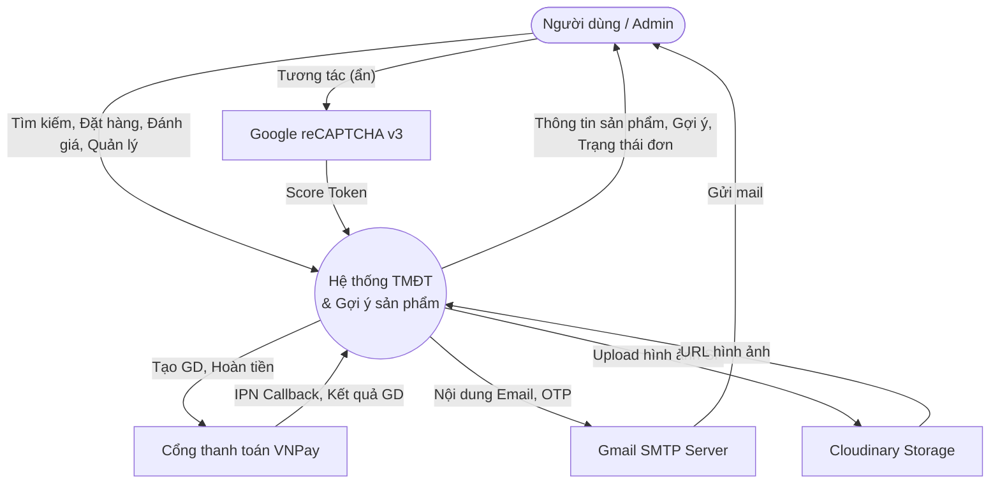
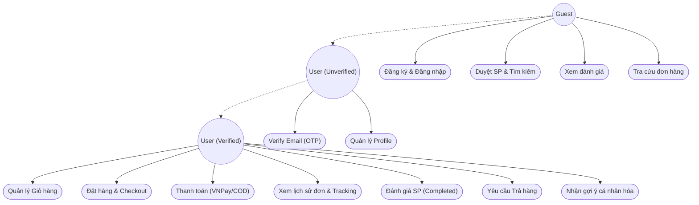
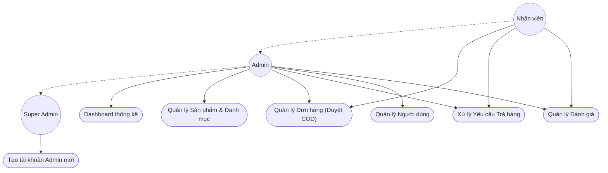
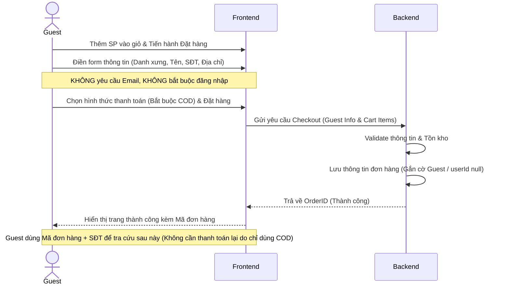
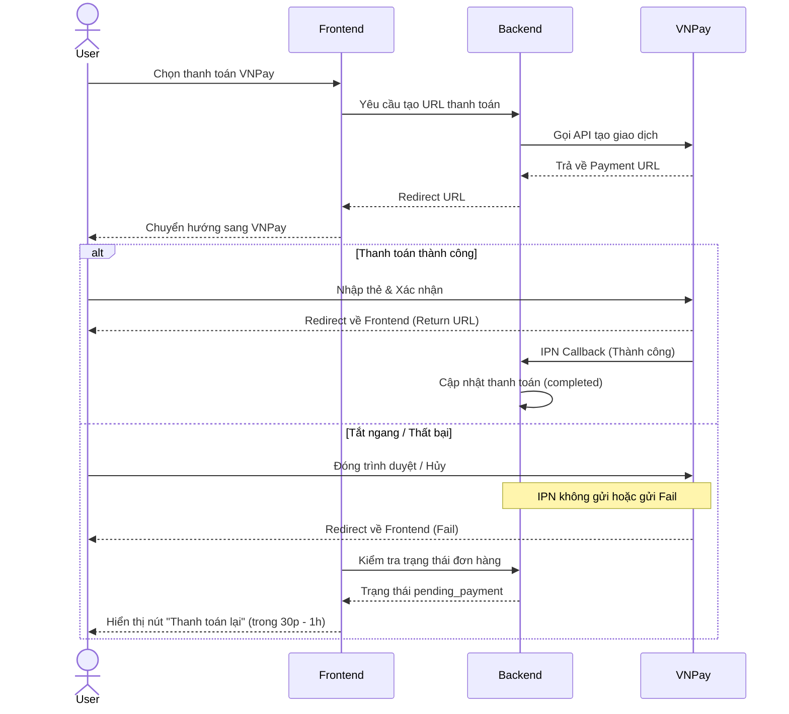
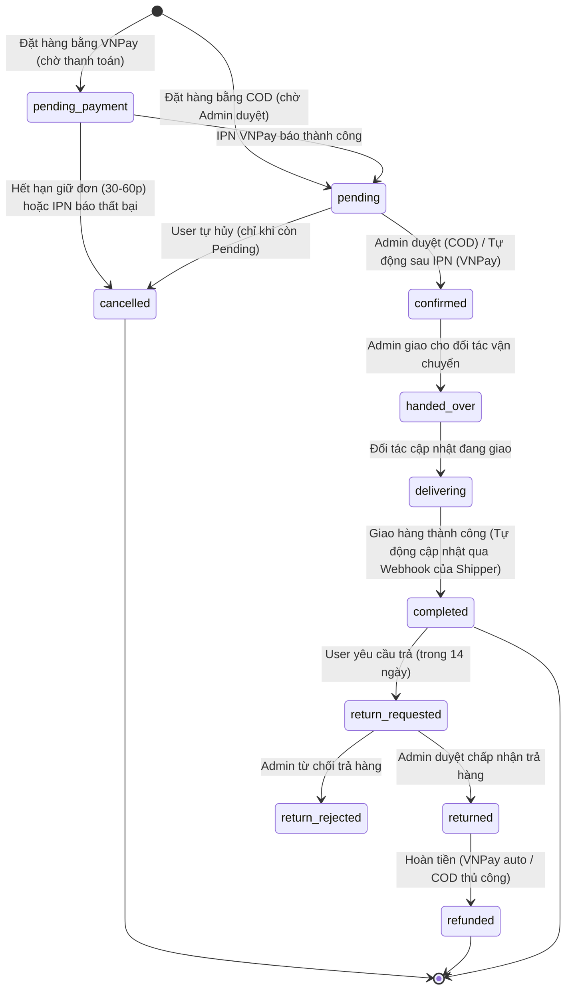

# TÀI LIỆU SRS: WEBSITE TMĐT ĐỒ ĐIỆN TỬ & HỆ THỐNG GỢI Ý (HYBRID RECOMMENDER)

## 1. Giới thiệu (Introduction)

### 1.1. Mục đích (Purpose)
Dự án nhằm xây dựng một Website Thương mại điện tử chuyên bán các sản phẩm đồ điện tử, kết hợp với Hệ thống gợi ý sản phẩm thông minh (Hybrid Recommender System). Mục đích cụ thể bao gồm:
1. **Trải nghiệm mua sắm mượt mà:** Xây dựng đầy đủ luồng E-commerce từ tìm kiếm, xem chi tiết, thêm giỏ hàng, đặt hàng đến thanh toán trực tuyến và đánh giá.
2. **Cá nhân hóa trải nghiệm:** Ứng dụng AI/Machine Learning để dự đoán và gợi ý những sản phẩm phù hợp nhất với sở thích của từng người dùng, giúp tăng tỷ lệ chuyển đổi.
3. **Mục đích học thuật (Đồ án tốt nghiệp):** Cung cấp môi trường thực tế để triển khai, so sánh và đánh giá các thuật toán gợi ý (Content-Based, Collaborative Filtering, Hybrid) bằng các độ đo chuẩn (Precision, Recall, RMSE).
4. **Vận hành tự động:** Tích hợp các hệ thống gửi email tự động, thông báo realtime và thanh toán qua cổng VNPay để giả lập một hệ thống hoạt động độc lập thực tế.

### 1.2. Phạm vi hệ thống (System scopes)
1. **Phạm vi chức năng:**
   - E-commerce: Quản lý sản phẩm, giỏ hàng, thanh toán (VNPay/COD), theo dõi đơn hàng realtime, luồng đổi trả và quản lý tài khoản.
   - Gợi ý sản phẩm: Gợi ý sản phẩm phổ biến (Cold-start), sản phẩm tương tự (Content-based) và sản phẩm dành riêng cho người dùng (Collaborative Filtering / Hybrid).
   - Quản trị: Admin Dashboard quản lý số liệu, duyệt trả hàng, quản lý người dùng và sản phẩm.
2. **Phạm vi công nghệ:**
   - Hệ thống chia làm 3 services chính: Frontend (Next.js 14), Backend (NestJS), ML Service (FastAPI).
   - Tương tác thời gian thực thông qua Server-Sent Events (SSE).
3. **Phạm vi đối tượng sử dụng:** Khách vãng lai, Người dùng (chưa verify & đã verify), Nhân viên, Admin, Super Admin.

### 1.3. Mục tiêu hệ thống (System objectives)
1. **Mục tiêu người dùng:** Cho phép khách hàng tìm kiếm, đặt mua đồ điện tử và theo dõi trạng thái đơn hàng một cách thuận tiện, an toàn.
2. **Mục tiêu kinh doanh (Giả lập):** Tăng trưởng doanh thu thông qua gợi ý cross-sell/up-sell tự động dựa trên hành vi mua và đánh giá.
3. **Mục tiêu khoa học:** So sánh trực tiếp hiệu năng của 4 mô hình: Popular (Baseline), Content-Based, SVD (CF), và Hybrid trên dataset Amazon Electronics.

---

## 2. Mô tả tổng quan về dự án (System overview)

### 2.1. Kiến trúc hệ thống (System architecture)
Hệ thống sử dụng kiến trúc **Monorepo** với 3 services chính, giao tiếp qua REST API nội bộ và hiển thị qua Next.js App Router.
- **Frontend (Giao diện):** Next.js 14, React, Shadcn UI, Zustand. Chịu trách nhiệm hiển thị và tương tác người dùng.
- **Backend (Core API):** NestJS, Prisma ORM. Quản lý nghiệp vụ chính, bảo mật, tương tác cơ sở dữ liệu MySQL và Redis (caching).
- **ML Service (AI Engine):** Python, FastAPI, Surprise, Scikit-learn. Load các mô hình (`.pkl`) đã train trước, trả về list `[product_id, score]` qua API nội bộ.
- **Database:** MySQL cho dữ liệu quan hệ (User, Product, Order). Redis cho caching session, OTP và kết quả Recommendation.

### 2.2. Sơ đồ luồng mức đỉnh (DFD Level 0)



### 2.3. Các yếu tố bên ngoài tác động (External factors)
| Yếu tố | Tác động | Giải pháp |
|---|---|---|
| **API Cổng thanh toán (VNPay)** | Cần mạng Internet để gọi VNPay, phụ thuộc vào tốc độ và uptime của sandbox VNPay. API hoàn tiền (Refund) trên Sandbox yêu cầu tài khoản Merchant doanh nghiệp có ký quỹ. | Có cơ chế fallback về thanh toán COD nếu VNPay lỗi; lưu trạng thái Pending rõ ràng; Backend chủ động xử lý và thông báo nghiệp vụ nếu refund trên Sandbox. |
| **Bảo mật và Bot spam (SMS OTP)** | Nguy cơ bị bot spam API đăng ký, rút cạn hạn ngạch SMS OTP, hoặc brute-force mã OTP. | Áp dụng Redis Rate Limiting theo SĐT (5 req/phút, khóa 15 phút nếu sai 3 lần) và IP để kiểm soát chi phí SMS; mock SMS log môi trường Dev. |
| **Hệ thống Email (SMTP)** | Lỗi mạng, email bị đánh dấu spam, hết hạn ngạch gửi mail miễn phí. | Sử dụng Nodemailer; cho phép resend OTP (tối đa 5 lần); lưu log gửi email để debug. |
| **Object Storage (Cloudinary)** | Quản lý lưu trữ ảnh sản phẩm, ảnh avatar. | Sử dụng duy nhất Cloudinary làm Object Storage chính thức để đơn giản hóa kiến trúc. |
| **ML Service (FastAPI)** | Quá trình dự đoán mô hình có thể chậm hoặc server Python sập/quá tải. | Timeout internal API (5s) và fallback trả về Popular Items; cache kết quả trong Redis 1 giờ. |
| **Đối tác vận chuyển (Grab/Be)** | Không có API thật, phụ thuộc vào việc Admin nhập tay đúng/kịp thời sau khi đặt xe ngoài hệ thống. | Quy trình thủ công (mục 5.6); không phát sinh rủi ro kỹ thuật tích hợp vì không gọi API bên ngoài. |

---

## 3. Yêu cầu chức năng (Functional requirements)

### 3.1. Sơ đồ Use Case

#### 3.1.1. Sơ đồ Use Case - Guest & User


#### 3.1.2. Sơ đồ Use Case - Admin


### 3.2. Chức năng Người dùng

| ID | Chức năng | Mô tả chi tiết | Quyền |
|---|---|---|---|
| FR-01 | Đăng nhập & Đăng ký Khách hàng | Khách hàng đăng nhập bằng Số điện thoại và xác thực OTP. Hệ thống tự động tạo tài khoản nếu SĐT chưa tồn tại. Áp dụng Redis Rate Limiting theo SĐT (5 req/phút, khóa 15 phút nếu sai 3 lần) để chống spam và brute-force. Không sử dụng mật khẩu hay email cho xác thực. Chờ tích hợp SMS Gateway (Twilio/Zalo ZNS). | Guest |
| FR-02 | Xác thực SMS OTP | Gửi OTP qua SMS/Zalo. Hiệu lực 5 phút. Nhập đúng -> cấp JWT. Sai 3 lần -> khóa 15 phút. Wording lỗi: *"Mã OTP không chính xác, vui lòng kiểm tra lại"*. | Guest |
| FR-03 | Đăng nhập Admin/Nhân viên | Dành riêng cho luồng quản trị: Admin và Nhân viên đăng nhập bằng Email và Mật khẩu. | Admin, Employee |
| FR-04 | Tìm kiếm & Lọc SP | Full-text search, lọc theo giá, category, rating. | All |
| FR-05 | Quản lý Giỏ hàng | Thêm, xóa, cập nhật số lượng SP. Số lượng trong giỏ không được vượt quá tồn kho (`stock`) của sản phẩm tại thời điểm thao tác. | All (Local), User |
| FR-06 | Checkout (Luồng Guest) | Guest chọn SP -> Điền form thông tin nhận hàng (Danh xưng, Tên, SĐT, Tỉnh/Huyện/Xã, Địa chỉ cụ thể) -> Hệ thống tạo đơn hàng trực tiếp không bắt buộc tạo tài khoản. Khách lưu đơn hàng với `userId = null`. Luồng Guest **CHỈ áp dụng thanh toán COD** (Thanh toán khi nhận hàng) để tối giản, tránh rủi ro thanh toán lỗi không thể retry. | All |
| FR-07 | Thanh toán & Nhận hàng | Khách hàng tuỳ chọn phương thức nhận hàng. Thanh toán VNPay (timeout 30 phút). COD sẽ tự động duyệt thành công dựa trên API Webhook đa kênh từ Shipper (GHN, SPX, Grab, Be...). | User (Ver) |
| FR-08 | Hủy đơn hàng | Cho phép hủy đơn khi trạng thái là `Pending` hoặc `pending_payment`. | User (Ver) |
| FR-09 | Trả hàng | Gửi yêu cầu trả hàng trong vòng 14 ngày sau khi đơn `Completed`. Bắt buộc chọn 1 trong 9 lý do hợp lệ (Lỗi NSX, Giao sai, Bể vỡ...). Admin có thể duyệt hoặc từ chối (`return_rejected`). Trạng thái `return_rejected` là trạng thái cuối (terminal), không thể yêu cầu trả hàng lại. | User (Ver) |
| FR-10 | Realtime Tracking | Xem lịch sử đơn hàng, nhận SSE push trạng thái realtime. | User (Ver) |
| FR-11 | Đánh giá Sản phẩm | Rate 1-5 sao và comment. *Chỉ đánh giá SP đã nhận hàng.* | User (Ver) |
| FR-12 | Cá nhân hóa (RecSys) | Nhận danh sách gợi ý trên Home/Detail/Profile theo tỷ lệ cân bằng: tối đa `60%–65%` sản phẩm cùng danh mục trọng tâm và `35%–40%` sản phẩm dựa trên lịch sử truy cập (`VIEW`), click (`CLICK`), tìm kiếm (`SEARCH`), thêm giỏ hàng (`ADD_TO_CART`) và mua hàng (`PURCHASE`) trước đó. | All, User (Ver) |
| FR-13 | Tra cứu đơn hàng | Bắt buộc nhập **Mã đơn hàng + SĐT** (2 yếu tố) để tra cứu trạng thái đơn — không cho tra cứu chỉ bằng SĐT để tránh lộ thông tin đơn hàng của người khác. | Guest, User |
| FR-14 | Quản lý Profile | Cập nhật thông tin cá nhân (Tên, Ảnh đại diện, Địa chỉ giao hàng mặc định), xem hạng thành viên VIP (`BRONZE`/`SILVER`/`GOLD`/`PLATINUM`), điểm tích lũy (`vipPoints`), danh sách đơn hàng gần đây, sản phẩm yêu thích và gợi ý AI cá nhân hóa. | User (Ver) |
| FR-15 | Xem chi tiết sản phẩm | Hiển thị mô tả chi tiết, ảnh gallery, phân trang đánh giá, khu vực Sản phẩm cùng danh mục (`RelatedCategoryProducts`), khu vực Gợi ý dành cho bạn (`RecommendedProducts`) và Sản phẩm vừa xem (`RecentlyViewedSlider`). | All |
| FR-16 | Khuyến mãi & Flash Sale | Xem danh sách SP Flash Sale đếm ngược theo thời gian thực (Countdown), xem badge giá sale gạch ngang, thu thập và áp dụng Voucher giảm giá khi Checkout. Hỗ trợ anti-stacking tự động giữa Voucher % và Flash Sale. | All, User (Ver) |

### 3.3. Chức năng Quản trị viên

| ID | Chức năng | Mô tả chi tiết | Quyền |
|---|---|---|---|
| FR-A01 | Dashboard | Thống kê doanh thu, đơn hàng, tỷ lệ hủy, SP bán chạy. | Admin |
| FR-A02 | Quản lý Sản phẩm & Danh mục | Thêm, sửa, ẩn/hiện danh mục (`GET /categories/admin`) và sản phẩm (`GET /products/admin`). Upload ảnh. | Admin |
| FR-A03 | Quản lý Đơn hàng & Giao hàng | Xem đơn (`GET /orders/admin`), duyệt đơn. Cho phép ghi nhận thông tin giao hàng thủ công như một cơ chế Fallback trong trường hợp luồng API Webhook của Shipper gặp lỗi. | Admin, Nhân viên |
| FR-A04 | Quản lý Trả hàng & Hoàn tiền | Duyệt/từ chối yêu cầu trả hàng (khi từ chối phải nhập `returnRejectReason`). Hoàn tiền VNPay tự động / COD thủ công -> Refunded (chỉ Admin — Nhân viên không có quyền hoàn tiền). | Admin, Nhân viên (duyệt trả); Admin (hoàn tiền) |
| FR-A05 | Quản lý Đánh giá | Xem, ẩn đánh giá vi phạm tiêu chuẩn cộng đồng. | Admin, Nhân viên |
| FR-A06 | Phân quyền Admin & Nhân viên | Super Admin được tạo/vô hiệu hóa (Soft Delete `isActive`) tài khoản Admin. Admin và Super Admin được mời Nhân viên qua email kèm link thiết lập mật khẩu một lần (`POST /auth/set-password`) và khóa/mở khóa tài khoản (chặn đăng nhập tức thì khi bị khóa). | Super Admin (Admin), Admin & Super Admin (Nhân viên) |
| FR-A07 | Quản lý Voucher | Tạo, sửa, thiết lập phạm vi áp dụng (CART/CATEGORY/PRODUCT), thời hạn, giới hạn lượt dùng hệ thống và giới hạn per-user cho mã giảm giá. Xem lịch sử sử dụng voucher (`VoucherUsageLog`). | Admin |
| FR-A08 | Quản lý Flash Sale | Thiết lập chương trình giảm giá theo thời gian (Custom Start/End Date), tỷ lệ giảm giá, giới hạn số suất sale (`flashSaleQty`), áp dụng cơ chế Atomic Claim chống oversell suất sale. | Admin |

### 3.4. Chức năng Machine Learning (Recommender System)

| ID | Chức năng | Mô tả chi tiết |
|---|---|---|
| FR-ML01 | Popular Items | Trả về Top-K phổ biến nhất (dựa trên viewCount, soldCount, avgRating). Dùng cho Cold-start giai đoạn 1. |
| FR-ML02 | Content-Based | Trả về SP tương tự dựa trên TF-IDF cosine similarity. Dùng cho Cold-start giai đoạn 2 (kết hợp UserActivityLog) và giai đoạn 3 (lịch sử mua hàng). |
| FR-ML03 | Collaborative | SVD predict điểm đánh giá của user đối với các SP chưa mua. |
| FR-ML04 | Hybrid | Kết hợp có trọng số giữa CB và CF. Dùng khi user đã có đủ reviews (giai đoạn 4). |
| FR-ML05 | Cache & Fallback| API gọi nội bộ, cache kết quả Redis 1 giờ. Nếu ML timeout, trả về Popular Items. |

---

### 3.5. Sơ đồ tuần tự (Sequence Diagrams)

#### 3.5.1. Luồng Guest Checkout (Không cần tài khoản)


**Lưu ý:** Luồng này tối ưu tỷ lệ chuyển đổi (conversion rate) bằng cách loại bỏ hoàn toàn ma sát từ việc bắt buộc đăng nhập hoặc xác thực OTP.

#### 3.5.2. Luồng Thanh toán VNPay (IPN Callback & Edge Cases)


### 3.6. Quy tắc nghiệp vụ (Business Rules)

#### 3.6.1. Sơ đồ trạng thái đơn hàng (Order Status State Diagram)

*Ghi chú: `pending_payment` áp dụng cho đơn VNPay hoặc đơn COD bắt buộc đặt cọc trực tuyến (mục 3.6.7) trong lúc chờ thanh toán; đơn COD thuần (không phải đặt cọc) đi thẳng vào `pending` (chờ Admin duyệt) vì không cần cổng thanh toán. Đơn ở `pending_payment` quá thời gian giữ đơn (mục 3.6.3) sẽ tự chuyển `cancelled` và nhả `stock` đã giữ.*

#### 3.6.2. Mã giảm giá (Voucher)
Có thể cấu hình giảm theo phần trăm (%) hoặc trừ một khoản tiền cố định. Mỗi voucher có điều kiện đi kèm (như mức giá đơn hàng tối thiểu, giới hạn tổng số lần sử dụng `usage_limit`). Ngoài giới hạn toàn hệ thống, **mỗi user chỉ được áp dụng 1 voucher cụ thể tối đa 1 lần** (theo dõi qua bảng `user_voucher_usage`, mục 4.2) để tránh lạm dụng.

#### 3.6.3. Giữ và giải phóng tồn kho (Stock Reservation)
Khi đơn được tạo (kể cả ở `pending_payment`), `stock` của sản phẩm được trừ tạm ngay trong transaction (row locking) để tránh oversell. Nếu đơn không hoàn tất thanh toán trong đúng **30 phút** (VNPay), một job định kỳ sẽ tự động chuyển đơn sang `cancelled` và **hoàn trả `stock`** đã giữ.

#### 3.6.4. Dọn dẹp tài khoản/đơn hàng tạm bỏ dở (Guest Cleanup Cronjob)
- **Đơn hàng tạm (Guest Order):** Nếu bị bỏ dở (chưa xác thực OTP), đơn sẽ bị job định kỳ xóa sau **24 giờ** và hoàn trả tồn kho.
- **Tài khoản chưa xác thực (Guest Account):** Nếu chưa kích hoạt sau **6 ngày**, hệ thống gửi 1 email cảnh báo. Nếu vẫn không kích hoạt đến **ngày thứ 7**, tài khoản sẽ bị tự động xóa kèm email thông báo đã xóa.

#### 3.6.5. Tích hợp Webhook Vận chuyển đa kênh
Sử dụng kiến trúc đa kênh, hệ thống tiếp nhận Webhook từ đối tác giao hàng. Điều kiện kiên quyết: Đơn COD phải được Admin duyệt tay (`pending` -> `confirmed`) trước khi Webhook có thể xử lý các trạng thái tiếp theo. API Webhook sẽ tự động cập nhật trạng thái đơn từ `handed_over` -> `delivering` -> `completed` theo thực tế. Webhook tuyệt đối không tự động duyệt đơn thay con người. Cập nhật thủ công chỉ áp dụng như phương án Fallback.

#### 3.6.6. Hệ thống Điểm thưởng (VIP Points)
- **Tích điểm (`earnedVipPoints`):** Người dùng nhận điểm thưởng sau khi đơn hàng hoàn tất (`completed`).
- **Tiêu điểm (`usedVipPoints`):** Áp dụng ngay khi thanh toán để giảm trừ trực tiếp tiền đơn hàng (Atomic Redeem để tránh Race-condition).
- **Điểm âm / Nợ điểm (`vipPointsDebt`):** Nếu khách hàng trả hàng (`returned`) nhưng điểm thưởng từ đơn đó đã bị sử dụng cho đơn khác, hệ thống sẽ đưa tài khoản vào trạng thái nợ điểm, trừ bù vào các giao dịch mua hàng tương lai.
- **Thời điểm hoàn điểm (`pointsCreditedAt`):** Lưu trữ chính xác thời gian điểm được hệ thống cộng vào ví.

#### 3.6.7. Cơ chế Thanh toán, Đặt cọc & Thanh toán lại (Repay)
- Mọi đơn hàng có tạm tính (`subtotal`) dưới ngưỡng **200.000 VNĐ** (bao gồm cả giao tận nơi lẫn nhận tại cửa hàng `PICKUP`) bắt buộc phải đặt cọc trước **50.000 VNĐ** qua cổng thanh toán trực tuyến (lưu vào `depositAmount`, cờ `isDepositPayment = true`).
- Đơn yêu cầu thanh toán trực tuyến (`paymentMethod = VNPAY` hoặc `isDepositPayment = true`) khởi tạo ở trạng thái `pending_payment` với hạn giữ đơn 30 phút (`paymentExpiresAt`). Sau khi IPN báo thành công, đơn chuyển sang `pending` với `paymentStatus` là `completed` (thanh toán toàn bộ) hoặc `partially_paid` (đặt cọc). Hỗ trợ thanh toán lại (`pay-again`) gia hạn 30 phút khi đơn ở `pending_payment`, hoặc mở lại đơn `cancelled` chỉ khi bị hủy tự động do hết hạn (`paymentExpiresAt !== null`), chưa có tiền về (`paymentStatus === pending`), không chứa ưu đãi đã hoàn trả và sản phẩm còn `isActive = true`. (Known Limitation: các đơn cũ đã bị User/Admin hủy trước thời điểm áp dụng xóa `paymentExpiresAt` khi hủy thủ công vẫn còn giữ `paymentExpiresAt` trong DB).

#### 3.6.8. Cơ chế An toàn Hoàn tiền (Refund Safeguards)
Đảm bảo tính toàn vẹn tài chính khi hoàn tiền:
- `refundStatus` (PROCESSING / COMPLETED): Quản lý luồng hoàn tiền bất đồng bộ từ cổng thanh toán.
- `isOrphanedPayment`: Cờ đánh dấu các thanh toán dư thừa, hoặc các thanh toán gửi về từ IPN nhưng đơn hàng đã bị hủy trước đó.
- `auditTrail`: Lưu trữ toàn bộ lịch sử (JSON) mọi thao tác đổi trạng thái và dòng tiền của đơn hàng để dễ dàng đối soát.

---

## 4. Yêu cầu về cơ sở dữ liệu (Database requirements)

### 4.1. ERD (Mức logic)

```
[USERS] 1 --- N [ORDERS] 1 --- N [ORDER_ITEMS] >- 1 [PRODUCTS] N --- 1 [CATEGORIES]
  |                                                  |
  | 1                                                | 1
  +--- N [REVIEWS] N --------------------------------+
  |                                                  |
  +--- N [CART_ITEMS] N -----------------------------+
```

### 4.2. Cấu trúc các bảng (MySQL)

**1. Bảng `users`**
- `id`: VARCHAR(UUID) (PK)
- `email`: VARCHAR (Unique, Nullable)
- `phone`: VARCHAR (Unique, Nullable - Bắt buộc ở tầng DTO đối với Customer)
- `password`: VARCHAR (Hash, Nullable)
- `role`: ENUM ('CUSTOMER', 'EMPLOYEE', 'ADMIN', 'SUPER_ADMIN')
- `is_active`: BOOLEAN (Default TRUE)
- `vipPoints`: INT (Điểm thưởng hiện có)
- `vipPointsDebt`: INT (Điểm nợ khi trả hàng)
- `created_at`, `updated_at`

**2. Bảng `categories`**
- `id`: INT (PK)
- `name_vi`: VARCHAR (Tên danh mục)
- `description_vi`: TEXT
- `slug`: VARCHAR (Unique)

**3. Bảng `products`**
- `id`: INT (PK)
- `title_vi`: VARCHAR (Tên Tiếng Việt)
- `description_vi`: TEXT
- `price`: DECIMAL (Giá VNĐ)
- `stock`: INT
- `image_url`: VARCHAR (URL Cloudinary)
- `category_id`: INT (FK categories)
- `is_active`: BOOLEAN (Default TRUE để soft-delete)
*(Ghi chú: Giả định phạm vi đồ án chỉ dùng 1 ảnh đại diện cho mỗi sản phẩm để tối ưu lưu trữ.)*

**4. Bảng `cart_items`**
- `id`: INT (PK)
- `user_id`: INT (FK users)
- `product_id`: INT (FK products)
- `quantity`: INT
*(Ghi chú: Cần thêm ràng buộc `UNIQUE(user_id, product_id)` để khi thêm SP đã có trong giỏ thì hệ thống chỉ cộng dồn `quantity`.)*

**5. Bảng `orders`**
- `id`: VARCHAR(UUID) (PK)
- `user_id`: VARCHAR(UUID) (FK users, Nullable)
- `total_amount`: DECIMAL
- `shipping_fee`: DECIMAL (Phí ship)
- `discount_amount`: DECIMAL (Số tiền giảm giá do voucher)
- `voucher_id`: VARCHAR(UUID) (FK vouchers, nullable)
- `depositAmount`: DECIMAL (Số tiền đặt cọc)
- `isDepositPayment`: BOOLEAN (Cờ đánh dấu đơn có đặt cọc)
- `earnedVipPoints`: INT (Điểm thưởng kiếm được)
- `usedVipPoints`: INT (Điểm thưởng sử dụng)
- `vipDiscountAmount`: DECIMAL (Số tiền giảm trừ từ điểm)
- `pointsCreditedAt`: TIMESTAMP (Thời gian cộng điểm)
- `isOrphanedPayment`: BOOLEAN (Cờ phát hiện GD bất thường)
- `refundStatus`: ENUM ('PROCESSING', 'COMPLETED')
- `auditTrail`: JSON (Lịch sử dòng tiền)
- `returnRejectReason`: TEXT (Lý do Admin từ chối trả hàng)
- `shipping_name`: VARCHAR
- `shipping_phone`: VARCHAR
- `shipping_address`: VARCHAR
- `delivery_method`: VARCHAR (Giao tiêu chuẩn, Hỏa tốc...)
- `delivery_partner`: VARCHAR (Tên đối tác thứ 3, vd: Grab, Be)
- `tracking_id`: VARCHAR (Mã vận đơn)
- `status`: ENUM ('pending', 'pending_payment', 'confirmed', 'handed_over', 'delivering', 'completed', 'return_requested', 'return_rejected', 'returned', 'refunded', 'cancelled')
- `payment_method`: ENUM ('vnpay', 'cod', 'stripe') (VietQR đã được duyệt thiết kế nhưng chưa cập nhật vào schema)
- `payment_status`: ENUM ('pending', 'partially_paid', 'completed', 'failed', 'refunded')
- `vnp_txn_ref`: VARCHAR
- `vnp_transaction_no`: VARCHAR
- `vnp_pay_date`: VARCHAR

**5.1. Bảng `provinces` & `wards` (Địa lý 2026 - Mới)**
- Bổ sung cấu trúc quản lý địa lý phân cấp (Vùng miền `region`: NORTH, CENTRAL, SOUTH).
- Bổ sung cờ `mergedFrom` để xử lý sáp nhập hành chính (ví dụ sáp nhập 2 xã thành 1 xã mới).

**5.1. Bảng `vouchers` (Mới)**
- `id`: INT (PK)
- `code`: VARCHAR (Unique)
- `discount_type`: ENUM ('percentage', 'fixed_amount')
- `discount_value`: DECIMAL
- `min_order_value`: DECIMAL
- `max_discount`: DECIMAL (Chỉ áp dụng khi discount_type là percentage)
- `usage_limit`: INT
- `used_count`: INT
- `valid_from`: TIMESTAMP
- `valid_to`: TIMESTAMP
- `is_active`: BOOLEAN

**5.2. Bảng `user_voucher_usage` (Mới)**
- `id`: INT (PK)
- `user_id`: INT (FK users)
- `voucher_id`: INT (FK vouchers)
- `order_id`: INT (FK orders)
- `used_at`: TIMESTAMP
*(Ghi chú: `UNIQUE(user_id, voucher_id)` để đảm bảo 1 user chỉ dùng 1 voucher tối đa 1 lần, độc lập với giới hạn toàn hệ thống ở `vouchers.usage_limit`.)*

**6. Bảng `order_items`**
- `id`: INT (PK)
- `order_id`: INT (FK orders)
- `product_id`: INT (FK products)
- `quantity`: INT
- `unit_price`: DECIMAL

**7. Bảng `reviews` (Nguồn dữ liệu chính cho RecSys)**
- `id`: INT (PK)
- `user_id`: INT (FK users)
- `product_id`: INT (FK products)
- `order_id`: INT (FK orders)
- `rating`: TINYINT (1-5)
- `comment`: TEXT
- `status`: ENUM ('visible', 'hidden') (Default 'visible' để soft-delete)
*(Ghi chú: Có ràng buộc `UNIQUE(user_id, product_id, order_id)` để đảm bảo 1 user chỉ đánh giá 1 SP 1 lần cho mỗi đơn hàng đã mua.)*

**8. Bảng `email_logs` (Lưu lịch sử gửi email)**
- `id`: INT (PK)
- `email`: VARCHAR
- `type`: ENUM ('otp', 'order_confirm', 'order_complete', 'reset_pass')
- `status`: ENUM ('success', 'failed')
- `sent_at`: TIMESTAMP

---

## 5. Yêu cầu tích hợp hệ thống khác (Integration requirements)

### 5.1. Tích hợp thanh toán (VNPay Sandbox)
- **Mục đích:** Xử lý thanh toán online và hoàn tiền.
- **Yêu cầu:** 
  - FR-V1: Tạo URL thanh toán an toàn (HMAC-SHA512).
  - FR-V2: Xử lý IPN callback để chuyển `payment_status` thành `completed`.
  - FR-V3: Cung cấp API Refund để hoàn tiền khi đơn chuyển trạng thái `Returned`. *(Lưu ý: Trên môi trường VNPay Sandbox, API hoàn tiền tự động chỉ khả dụng cho tài khoản Merchant doanh nghiệp có ký quỹ; Backend chủ động xử lý và trả về thông báo lỗi nghiệp vụ rõ ràng, ngăn chặn desync dữ liệu)*.

### 5.2. Tích hợp Email (Nodemailer + Gmail SMTP)
- **Mục đích:** Gửi thông báo hệ thống tự động. Text đơn giản. Hệ thống KHÔNG gửi OTP đăng nhập/đăng ký Khách hàng qua Email (chuyển sang SMS).
- **Yêu cầu:** 
  - FR-E1: Gửi hóa đơn khi đặt thành công.
  - FR-E2: Gửi mail chúc mừng + link đánh giá khi đơn `Completed`.
  - FR-E3: Gửi link/OTP đặt lại mật khẩu cho Admin/Nhân viên (hết hạn 15p, giới hạn 5 lần).

### 5.3. Cơ chế Chống Spam & Brute-force (Redis Rate Limiting)
- **Mục đích:** Ngăn chặn bot spam rút cạn hạn ngạch SMS OTP, chống tấn công brute-force mã OTP và bảo vệ các endpoint nhạy cảm.
- **Yêu cầu:** Áp dụng Rate Limiting theo Số điện thoại và IP trên Redis (tối đa 5 lượt gửi OTP/phút; khóa 15 phút nếu xác thực sai 3 lần liên tiếp). Môi trường Dev giả lập log SMS an toàn.

### 5.4. Tích hợp lưu trữ hình ảnh (Cloudinary)
- **Mục đích:** Giảm tải cho server, lưu trữ và resize hình ảnh nhanh chóng.
- **Yêu cầu:** Admin upload hình ảnh sản phẩm -> Gọi API Cloudinary -> Lưu URL trả về vào DB.

### 5.5. Tích hợp Hệ thống AI (FastAPI ML Service)
- **Mục đích:** Trả về kết quả gợi ý.
- **Yêu cầu:** Internal REST API `GET /recommend/hybrid/{user_id}`. Timeout 5 giây. NestJS gọi và cache vào Redis trong 1 giờ.

### 5.6. Tích hợp Webhook Vận chuyển đa kênh (Grab/Be/GHN/SPX)
- **Mục đích:** Tự động hóa quá trình xác nhận giao hàng và cập nhật hành trình đơn.
- **Yêu cầu:** Hệ thống triển khai một Endpoint Webhook mở. Bất kỳ đối tác giao hàng nào khi hoàn tất trạng thái lấy hàng, đang giao, giao thành công đều có thể bắn POST request về Webhook này (kèm signature xác thực). Hệ thống dựa vào payload để đóng đơn COD tự động. (Trong phạm vi demo đồ án có thể dùng Postman để giả lập gọi Webhook thay cho Server thật của bên vận chuyển).

---

## 6. Yêu cầu phi chức năng (Non-Functional requirements)

1. **Hiệu năng & Thời gian thực (Performance & Realtime):**
   - API response time < 500ms.
   - Ứng dụng Server-Sent Events (SSE) để push trạng thái đơn hàng (Pending -> Confirmed -> Shipping...) về Frontend tự động không cần F5.
2. **Tính toàn vẹn dữ liệu (Data Integrity):**
   - Áp dụng cơ chế Row locking (`SELECT ... FOR UPDATE` trong transaction) hoặc Optimistic locking khi trừ `stock` (tồn kho) lúc Checkout để tránh Race condition gây oversell (bán vượt quá số lượng).
3. **Bảo mật (Security):**
   - JWT cho Authentication (Access token 15 phút, Refresh 7 ngày).
   - Tự động phát hành lại Access Token mới (cấp quyền verified) ngay khi nhập đúng OTP, không bắt user login lại.
   - Hash password bằng bcrypt (salt 10). Sanitize mọi input chống XSS, SQLi (thông qua Prisma ORM).
4. **Mở rộng (Scalability & DevOps):**
   - Áp dụng Module-based trong NestJS, dễ dàng thêm module mới. Phân tách rõ Frontend và Backend (Decoupled).
   - Chiến lược Backup: Dump DB MySQL định kỳ hàng ngày lên cloud storage hoặc lưu trữ nội bộ.
   - Logging/Monitoring: Ghi log lỗi vào file hoặc console chuẩn để phục vụ debug (VD: VNPay callback lỗi, ML Service down).
   - Uptime/Availability: Mục tiêu hệ thống hoạt động ổn định 99% thời gian để phục vụ người dùng và demo.
5. **Tương thích:** Responsive trên Mobile, Tablet, Desktop. Hỗ trợ Chrome, Safari, Edge.
6. **Đa ngôn ngữ (i18n):** Bắt buộc áp dụng Đa ngôn ngữ 100% bằng thư viện `next-intl` cho mọi giao diện. Nghiêm cấm hardcode chuỗi văn bản tĩnh.

---

## 7. Yêu cầu về đánh giá mô hình (Model Evaluation Requirements)

Đây là thành phần học thuật cốt lõi của đồ án.
1. **Phương pháp:** Offline evaluation trên dataset Amazon Electronics (đã tiền xử lý 5-core). Split Train/Test 80/20.
2. **Metrics đánh giá Rank:** Precision@10, Recall@10, NDCG@10 (Threshold relevant là rating >= 4 sao).
3. **Metrics đánh giá Rating:** RMSE, MAE (Áp dụng cho SVD và Hybrid).
4. **Yêu cầu code:** Viết file `evaluate.py` in ra bảng so sánh rõ ràng giữa 4 mô hình để đưa vào báo cáo quyển.

---

## 8. Viết Unit Test

Yêu cầu phủ sóng các module lõi (Sử dụng Jest / Pytest):
- **Auth Module:** Test sinh token hợp lệ, test luồng nhập sai OTP 5 lần bị khóa.
- **Order Module:** Test logic tính tiền, trừ stock, và chuyển trạng thái đơn (kể cả return flow).
- **Payment & Email:** Mock VNPay API, mock Nodemailer để không gửi mail thật khi chạy test.
- **ML Service:** Test endpoint fallback về popular khi user_id không tồn tại (cold start).

---

## Phụ lục

### A. Lịch trình Phát triển 16 tuần (WBS & Checkpoints)

| Giai đoạn | Tuần | Công việc chính | Cần gạt rủi ro (Fallback Checkpoint) |
|---|---|---|---|
| **1. Khởi tạo** | 1-2 | Thiết kế DB, kiến trúc, deploy server trống lên Railway. | |
| **2. Auth & Core** | 3-5 | Auth JWT, OTP Email, reCAPTCHA, Quản lý Sản phẩm (Cloudinary). | |
| **3. Checkout** | 6-8 | Giỏ hàng, Đặt hàng 5 bước, VNPay Sandbox. | |
| **4. ML & AI** | 9-11 | Train model SVD, CB, Hybrid. Code FastAPI inference. | **CKPT 1 (Cuối T10):** Nếu kẹt AI -> Bỏ SSE & Email phụ, dồn lực AI. |
| **5. Nâng cao** | 12-14 | Đánh giá SP, Dashboard, Luồng trả hàng (Return), SSE Realtime. | **CKPT 2 (Đầu T13):** Nếu luồng đặt hàng còn lỗi -> Hủy luồng trả hàng. |
| **6. Đóng gói** | 15-16 | Unit test, trích xuất chỉ số Evaluation (RMSE, NDCG), viết báo cáo. | |

### B. Các câu hỏi mở / Chờ quyết định
1. **Nền tảng Deploy (Railway vs Supabase):** Đã chốt chọn Railway. Lý do: Ứng dụng có cả backend NestJS và FastAPI ML, Railway hỗ trợ Docker và chạy đa service dễ dàng, phù hợp hơn Supabase (vốn thiên về Backend-as-a-Service).
2. **Tính năng điểm thưởng (VIP Points):** Đã thực hiện. Khách hàng được tích điểm (`earnedVipPoints`) để dùng trừ tiền trực tiếp cho lần mua sau. Đã xử lý toàn vẹn dữ liệu nợ điểm (`vipPointsDebt`) khi người dùng trả hàng.
3. **Đa ngôn ngữ (i18n):** Đã chốt bắt buộc 100% (next-intl).
4. **Tài khoản test VNPay:** Yêu cầu admin/bạn cung cấp credentials VNPay Sandbox lưu vào file `.env` khi code module thanh toán.