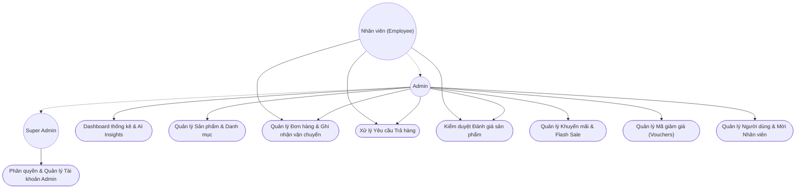

# Use Case - Quản trị Hệ thống (Admin, Employee & Super Admin)

Sơ đồ Use Case thể hiện phân quyền các chức năng quản trị hệ thống dành cho Nhân viên (Employee), Quản trị viên (Admin) và Quản trị cấp cao (Super Admin).

