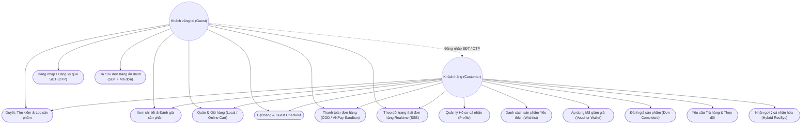

# Use Case - Khách vãng lai (Guest) & Khách hàng (Customer)

Sơ đồ Use Case thể hiện các chức năng mà Guest (Khách vãng lai) và Customer (Khách hàng đã đăng nhập bằng SĐT) có thể thực hiện trên hệ thống TMĐT.

