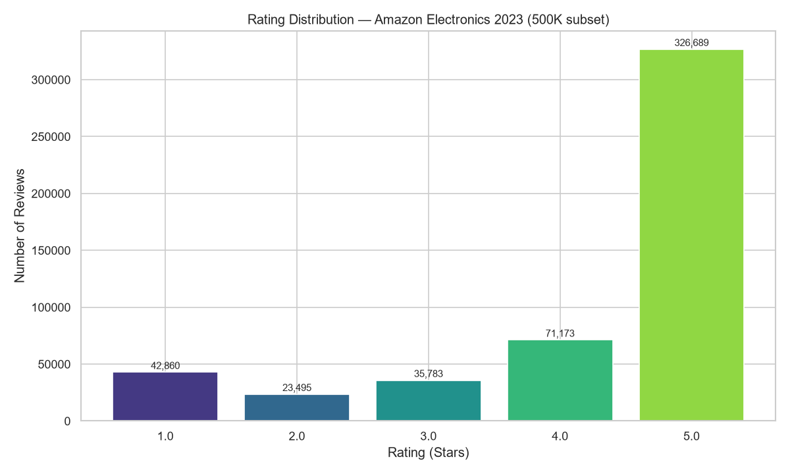
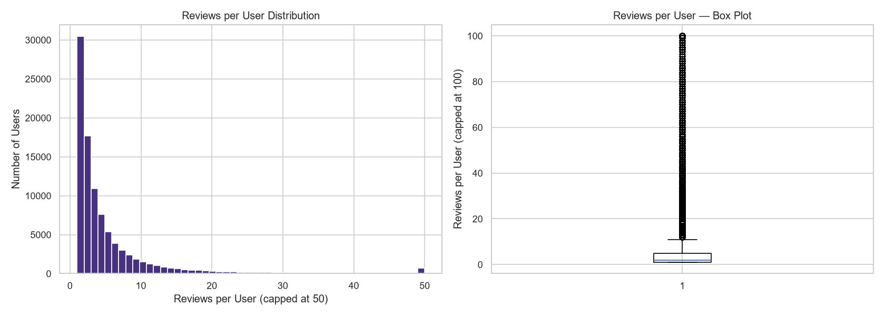
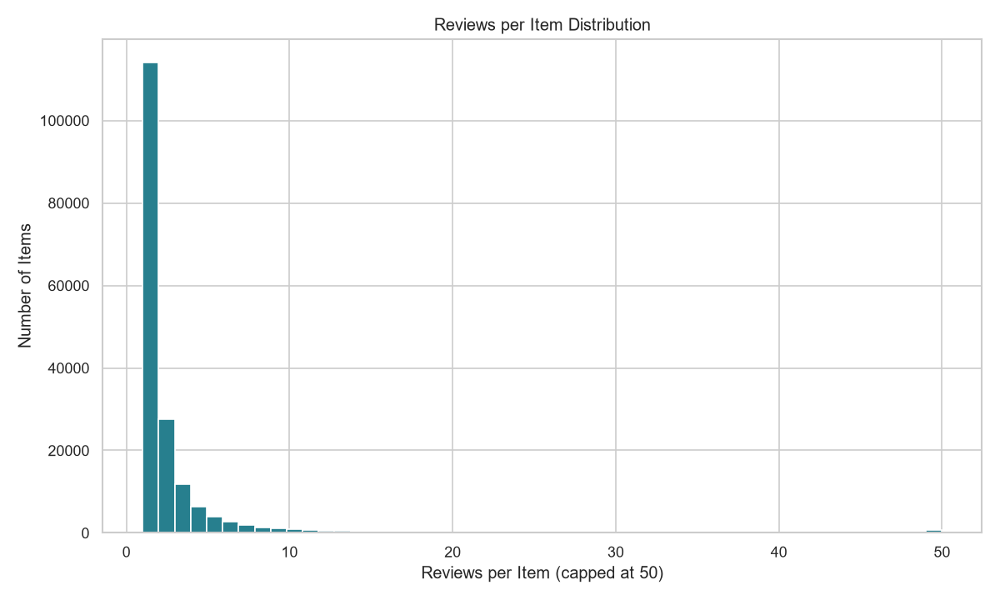
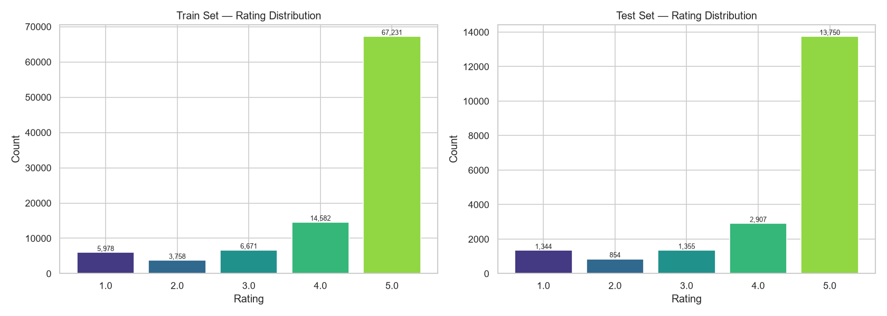

# Báo cáo Phân tích Dữ liệu Khám phá (EDA)
**Dataset:** Amazon Electronics Reviews 2023

Quá trình tiền xử lý và EDA được thực hiện bằng script `01_eda.py` ở Tuần 1. Dưới đây là tóm tắt kết quả phân tích.

## 1. Dữ liệu ban đầu
- **Tổng số reviews:** 500,000
- **Users duy nhất:** 94,898
- **Items duy nhất:** 177,727
- **Độ thưa thớt (Sparsity):** 99.9970%
- **Trung bình:** Mỗi user đánh giá khoảng 5.27 sản phẩm, nhưng đa số chỉ đánh giá 1-2 sản phẩm (median = 2).

### Phân phối Rating
Đa số rating trên Amazon đều tích cực (5 sao).

### Phân phối Review theo User & Item

---

## 2. Tiền xử lý: Lọc 5-Core
Để mô hình Collaborative Filtering có thể học tốt, dữ liệu được lọc theo chuẩn 5-core: loại bỏ tất cả các user có ít hơn 5 đánh giá và các item có ít hơn 5 đánh giá. Quá trình lọc lặp (iterative) mất 13 bước để ổn định hoàn toàn.

**Kết quả sau khi lọc (5-core):**
- **Tổng số reviews:** 118,430 (23.7% ban đầu)
- **Users:** 11,963
- **Items:** 9,073
- **Độ thưa thớt (Sparsity):** 99.8909% (đã giảm, dữ liệu đặc hơn đáng kể)

---

## 3. Chia Train/Test (Per-user split)
Chia dữ liệu theo phương pháp **80/20 per-user random split** nhằm đảm bảo mọi user xuất hiện trong tập Test cũng bắt buộc có mặt trong tập Train. Điều này khắc phục lỗi cold-start (không có dữ liệu dự đoán) khi chạy SVD.

- **Tập Train:** 98,220 reviews (82.9%)
- **Tập Test:** 20,210 reviews (17.1%)
- **Xác thực:** ✅ 100% (11,963) user ở tập Test đều xuất hiện trong tập Train (no cold-start leak).

### Phân phối Rating giữa Train và Test
Phương pháp chia phân phối đều sự đa dạng rating ở cả hai tập:

---
*Báo cáo được trích xuất tự động từ quá trình chạy `ml/scripts/01_eda.py`.*
